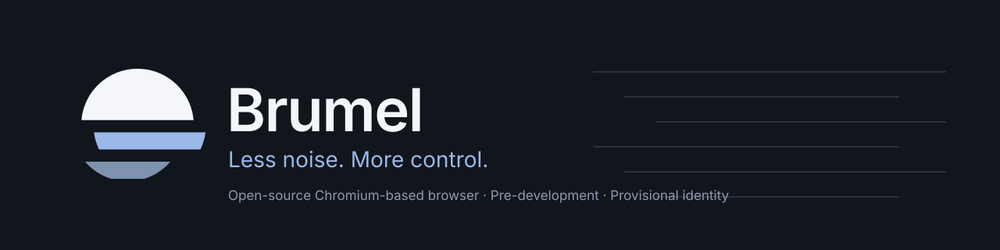

  

  <strong>An open-source Chromium-based browser designed around performance, privacy, reliability, and user control.</strong>

  
  
  

> [!IMPORTANT]
> **Brumel is in pre-development. There is no working build and no public release yet.**
> Everything described below as a feature is **planned or under research** unless explicitly
> marked otherwise. Nothing here should be read as a claim about what Brumel already does.

> [!NOTE]
> The logo and visual identity are **provisional**. Five proposals are open for feedback in
> [`assets/branding`](assets/branding/README.md).

## Why Brumel

Modern browsers are excellent rendering engines wrapped in increasingly noisy products:
background services you never asked for, memory that grows with every tab, sessions lost to a
crash or an update, ads and trackers by default, accounts and subscriptions pushed into basic
features, and data that is hard to take with you when you leave.

Brumel's bet is simple:

> **A browser can have hundreds of features available without all of them running all the time.**

Brumel starts from Chromium — for compatibility with the modern web and with Chromium
extensions — and focuses its own work on what people struggle with every day: resource use,
lost context, web clutter, trust, and small everyday tasks that should not need a separate tool.

## Five pillars

| Pillar | What it means | Examples (all **planned**) |
|---|---|---|
| **Efficiency** | Use the machine's resources deliberately. | Smart Optimize, RAM budgets, Infinite Tabs, Extension Doctor, Idle Scheduler |
| **Memory** | Never lose information or context. | Browser Time Machine, Draft Protection, Universal Undo, Resume Cards |
| **Clean Web** | Browse without invasive ads and needless interruptions. | Native ad/tracker blocking, cookie-banner rejection, notification-prompt blocking |
| **Trust** | Privacy and security you can verify. | Glass Box connection log, Extension Passport, signed builds, no mandatory telemetry |
| **Everyday Tools** | Solve common problems directly in the browser. | Smart Upload, Tables to Data, Live Text, Mobile Upload |

**Brumel Nano** — optional, free, local AI — is a cross-cutting technology that supports these
pillars where it is measurably better than deterministic code. It is never mandatory and never the
only argument for using Brumel.

## Principles

- Maximum web and Chromium-extension compatibility.
- Privacy by design: **no mandatory telemetry, no mandatory accounts, no mandatory subscriptions**
  for essential features, no invasive first-party advertising.
- Local-first: everything works offline and without sync; data is portable and exportable in open
  formats.
- Security first: Brumel never weakens Chromium's sandbox, site isolation or exploit mitigations to
  win a benchmark.
- Optional features can be **fully disabled** and must stop consuming resources when they are.
- Simple by default, powerful when needed: familiar layout, progressive disclosure.
- Verifiable transparency: public code, reproducible builds as a goal, a log of every connection
  the browser initiates.
- No Electron. Brumel is a native Chromium browser.

Read the full [Vision](docs/product/VISION.md).

## What we plan to build

The [master feature catalog](docs/product/FEATURES.md) tracks **339 entries** (306 distinct
features plus 33 technical duplicates kept for traceability), each with a stable ID, problem, use
case, risks, acceptance criteria and phase. It includes the
[52 research proposals](docs/product/FEATURES.md#the-52-research-proposals) that came out of a
critical product analysis. Inclusion in the catalog is **not** a promise: every item carries a
status — `Planned`, `Research`, `Experimental`, `Deferred` or `Rejected`.

| Module | Focus |
|---|---|
| **Brumel Core** | Chromium parity, Google-service replacements, signed updates, module system |
| **Brumel Engine** | Performance profiles, budgets, tab lifecycle, diagnostics |
| **Brumel Workspace** | Vertical tabs, trees, workspaces, identities, universal search |
| **Brumel Memory** | Session history, recovery, local search, data portability |
| **Brumel Shield** | Content blocking, permissions, extension control, transparency |
| **Brumel Nano** | Optional on-device AI in an isolated, network-less process |
| **Brumel Connect** | Local-first, end-to-end encrypted sync and device continuity |
| **Brumel Tools** | Downloads, media, capture, reading, accessibility, file utilities |
| **Brumel Dev** | Developer tools (automation and agents deferred behind a capability model) |

How Brumel compares with other browsers today is tracked — conservatively — in the
[feature matrix](docs/product/FEATURE_MATRIX.md).

## Architecture at a glance

- **Base:** Chromium upstream, pinned to stable tags, plus a Brumel patch series and selected
  [ungoogled-chromium](https://github.com/ungoogled-software/ungoogled-chromium) patches. The
  repository never contains a copy of Chromium. See
  [Chromium bases compared](docs/research/CHROMIUM_BASES.md) and
  [ADR-0002](docs/architecture/adr/0002-chromium-base-selection.md).
- **UI:** C++ and Chromium Views for the browser frame; WebUI (TypeScript, Lit) for internal pages.
- **Modules:** in-process components behind feature flags, created lazily and unloaded when
  disabled. No process per module; heavy work (AI inference, indexing, OCR) runs in sandboxed
  utility processes.
- **Data:** one local store per profile on SQLite with full-text search, encrypted at rest.
- **Rust** for new, isolated, memory-safety-sensitive components.

Details: [ARCHITECTURE.md](docs/architecture/ARCHITECTURE.md) ·
[UPSTREAM_STRATEGY.md](docs/architecture/UPSTREAM_STRATEGY.md) ·
[Architecture Decision Records](docs/architecture/adr/README.md)

## Local AI (Brumel Nano)

- Free, optional, downloaded as a separate component, removable at any time.
- Runs locally in a sandboxed process **with no network access**, loaded on demand and unloaded
  when idle; disabled automatically by power-saving profiles.
- **Deterministic first:** rules and classic algorithms are used whenever they are cheaper and more
  reliable than a model.
- Candidate models under evaluation include Gemma 3 270M, FunctionGemma, EmbeddingGemma,
  Qwen3 0.6B and Gemma 3 1B, on llama.cpp and ONNX Runtime. Nothing is selected yet.
- Web content is always treated as untrusted data: pages cannot trigger privileged actions through
  prompts. Small models are **not** used for security decisions or autonomous agents.
- Optional, opt-in cloud providers (OpenAI-compatible APIs, Claude, Gemini, Ollama, bring your own
  key).

See [AI_ARCHITECTURE.md](docs/architecture/AI_ARCHITECTURE.md).

## Privacy and sync

Brumel works fully without an account. Sync (Brumel Connect) is planned as **local-first and
end-to-end encrypted in the client**: a server only stores ciphertext, can be self-hosted with
Docker, and is never a hard dependency. Password sync is deferred until it passes a dedicated
security review.

See [PRIVACY.md](docs/privacy/PRIVACY.md) and
[SYNC_ARCHITECTURE.md](docs/architecture/SYNC_ARCHITECTURE.md).

## Performance

Brumel's performance goals are **hypotheses, not results**: for example, 20–40 % less RAM and
15–30 % less energy than stock Chrome in comparable workloads. They will be tested with a public,
reproducible methodology — same pages, hardware, settings and extensions — and published with raw
data, including when Brumel loses.

See [BENCHMARKS.md](docs/benchmarks/BENCHMARKS.md).

## Platforms

| Platform | Status |
|---|---|
| Windows 10/11 x64 | Planned — primary target |
| Linux x64 | Planned — primary target |
| Windows / Linux ARM64 | Planned, after x64 |
| macOS | Deferred (signing, notarization and CI hardware) |
| Android | Future (Phase 6) |

## Roadmap

| Phase | Focus |
|---|---|
| **0 · Pre-development** ← *we are here* | Identity, documentation, catalog, architecture, licensing, security model |
| 1 · Technical Foundation | Reproducible upstream fetch, patch system, branding, signed updater, module system |
| 2 · Internal Alpha | Chromium parity, vertical tabs, Clean Web, memory management, session restore |
| 3 · Public Alpha | Smart Optimize, Infinite Tabs, Time Machine, Glass Box, migration, verifiable installers |
| 4 · Public Beta | Brumel Nano, workspaces, encrypted sync, accessibility, security audits, public benchmarks |
| 5 · Version 1.0 | Stability, reliable security updates, sustainable infrastructure |
| 6 · Future | Android, developer platform, isolated agents, community ecosystem |

No dates are promised. Read the full [ROADMAP](ROADMAP.md).

## Documentation

| Area | Documents |
|---|---|
| Product | [Vision](docs/product/VISION.md) · [Features](docs/product/FEATURES.md) · [Feature matrix](docs/product/FEATURE_MATRIX.md) · [Product requirements](docs/product/PRODUCT_REQUIREMENTS.md) · [Roadmap](ROADMAP.md) |
| Architecture | [Architecture](docs/architecture/ARCHITECTURE.md) · [AI](docs/architecture/AI_ARCHITECTURE.md) · [Sync](docs/architecture/SYNC_ARCHITECTURE.md) · [Upstream strategy](docs/architecture/UPSTREAM_STRATEGY.md) · [Compatibility](docs/architecture/COMPATIBILITY.md) · [ADRs](docs/architecture/adr/README.md) |
| Security & privacy | [Security policy](SECURITY.md) · [Threat model](docs/security/THREAT_MODEL.md) · [Privacy](docs/privacy/PRIVACY.md) |
| Development | [Building](docs/development/BUILDING.md) · [Infrastructure](docs/development/INFRASTRUCTURE.md) · [Benchmarks](docs/benchmarks/BENCHMARKS.md) · [Patches](patches/README.md) · [Scripts](scripts/README.md) |
| Research | [Research agenda](docs/research/RESEARCH.md) · [Chromium bases](docs/research/CHROMIUM_BASES.md) · [Name check](docs/research/NAME_CHECK.md) |
| Design | [Design system](docs/design/DESIGN_SYSTEM.md) · [Brand assets](assets/branding/README.md) |
| Community | [Contributing](CONTRIBUTING.md) · [Community](docs/community/COMMUNITY.md) · [Governance](GOVERNANCE.md) · [Code of conduct](CODE_OF_CONDUCT.md) · [Good first issues](docs/development/GOOD_FIRST_ISSUES.md) |
| Legal | [Licensing](docs/legal/LICENSING.md) · [Third-party notices](THIRD_PARTY_NOTICES.md) |

Full index: [docs/README.md](docs/README.md).

## Get involved

Brumel is being built in public from day zero. Right now the most valuable contributions are
**not code**:

- Challenge the plan: is a feature solving a real problem? Is a priority wrong?
- Verify facts in the [feature matrix](docs/product/FEATURE_MATRIX.md) and
  [research agenda](docs/research/RESEARCH.md).
- Give feedback on the [logo proposals](assets/branding/README.md).
- Share Chromium build and patch-maintenance experience.

Where:

- **[Discussions](https://github.com/Elgeryy1/brumel/discussions)** — ideas, questions, feedback.
- **[Issues](https://github.com/Elgeryy1/brumel/issues)** — epics, tasks and research items, using
  the issue forms.
- **[Project board](https://github.com/users/Elgeryy1/projects)** — "Brumel — Development",
  the planning view of the backlog.

Start with [CONTRIBUTING.md](CONTRIBUTING.md). Contributions use a
[DCO sign-off](CONTRIBUTING.md); please report vulnerabilities privately as described in
[SECURITY.md](SECURITY.md).

## License and attribution

- Brumel's own source files are licensed under the **[Mozilla Public License 2.0](LICENSE)**.
- Patches that modify Chromium-derived files are licensed under **BSD-3-Clause**, like the files
  they modify, so they can be upstreamed.
- Chromium and every third-party component keep their own licenses — see
  [THIRD_PARTY_NOTICES.md](THIRD_PARTY_NOTICES.md) and [LICENSING.md](docs/legal/LICENSING.md).
- "Brumel" and the Brumel logo are not licensed under the MPL; see the draft trademark guidelines
  in [LICENSING.md](docs/legal/LICENSING.md).

Brumel is an independent, personal open-source project by Gerard Alvear
([@Elgeryy1](https://github.com/Elgeryy1)). It is not affiliated with or endorsed by Google, the
Chromium project, or any other browser vendor. Chromium is a trademark of Google LLC.
