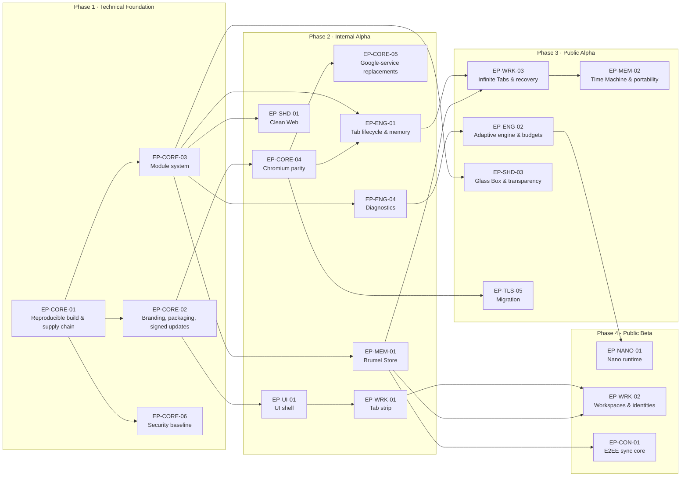

# Brumel Roadmap

> **Status: Pre-development.** There is no build of Brumel yet. This roadmap is ordered by
> **dependencies**, not by calendar dates. No release date will be announced until the project
> has measured its real development capacity (see [Why there are no dates](#why-there-are-no-dates)).

The roadmap is the human-readable view of the [feature catalog](docs/product/FEATURES.md).
Every item below references stable catalog IDs (`ENG-018`, `EP-SHD-01`, …) so progress can be
traced from this document to the catalog, to GitHub Issues and to the
[GitHub Project](https://github.com/users/Elgeryy1/projects/2).

Phases map 1:1 to GitHub milestones:

| Phase | Milestone | Goal in one sentence | Exit gate |
|---|---|---|---|
| 0 | Pre-development | Decide what to build and how, before writing browser code. | Foundations documented, base and license decided, backlog organized. |
| 1 | Technical Foundation | Produce a reproducible, signed, rebranded Chromium build from a pinned upstream tag. | Two consecutive upstream stable updates rebased and shipped internally. |
| 2 | Internal Alpha | A daily-drivable browser for the maintainer with Chromium parity and the first Brumel differentiators. | Maintainer uses it as the only browser for a full upstream cycle. |
| 3 | Public Alpha | First public, verifiable builds focused on Efficiency, Memory, Clean Web and Trust. | External testers can install, update and report issues safely. |
| 4 | Public Beta | Brumel Nano, workspaces and encrypted sync; broad stability and accessibility work. | Security review of Nano and Connect completed; public benchmarks published. |
| 5 | Version 1.0 | A dependable daily browser with a reliable security-update process. | Release criteria in [PRODUCT_REQUIREMENTS.md](docs/product/PRODUCT_REQUIREMENTS.md) met. |
| 6 | Future Releases | Android, developer platform, isolated agents and community-driven growth. | Continuous. |

Catalog distribution today (generated from
[`features.json`](docs/product/catalog/features.json); includes technical duplicates that are
tracked with `duplicate_of`):

| Phase | 0 | 1 | 2 | 3 | 4 | 5 | 6 |
|---|---|---|---|---|---|---|---|
| Catalog entries | 6 | 17 | 66 | 101 | 130 | 1 | 19 |

Phase 4 is intentionally large: many items there are **Research** and will be split, re-phased
or deferred once Phases 2–3 produce real measurements. Rejected items keep phase 0 and are listed
for transparency, not as plans.

---

## Dependency overview

The full epic dependency list lives in
[`epics.json`](docs/product/catalog/epics.json) (`depends_on`) and is mirrored as
"blocked by" relationships on GitHub Issues where the API allows it.

---

## Phase 0 — Pre-development

**Goal:** make the important decisions explicitly and in public before any browser code exists.

| Area | Deliverable | Status |
|---|---|---|
| Identity | Five logo proposals, provisional mark, banner, favicon, social preview — [branding](assets/branding/README.md) | Available (provisional) |
| Repository | Public repo, templates, CI for docs, Discussions, Project, milestones, labels | Available |
| Documentation | Vision, PRD, architecture, security, privacy, AI, sync, benchmarks, building, upstream strategy | Available (living documents) |
| Catalog | Master catalog with stable IDs, 40 epics — [FEATURES.md](docs/product/FEATURES.md) | Available |
| Base selection | Chromium upstream + Brumel patches + selected ungoogled-chromium patches — [ADR-0002](docs/architecture/adr/0002-chromium-base-selection.md) | Decided (provisional until the Phase 1 spike) |
| License | MPL-2.0 for Brumel files, BSD-3-Clause for patches to Chromium files — [ADR-0004](docs/architecture/adr/0004-licensing.md) | Decided |
| Security model | [SECURITY.md](SECURITY.md), [THREAT_MODEL.md](docs/security/THREAT_MODEL.md) | Available (first version) |
| Build strategy | [BUILDING.md](docs/development/BUILDING.md), [UPSTREAM_STRATEGY.md](docs/architecture/UPSTREAM_STRATEGY.md) | Available (requirements to validate) |
| AI research | Model evaluation program (`NANO-006`) — candidate models and quality gates | Research |
| Name | [Preliminary name check](docs/research/NAME_CHECK.md) — not legal clearance | Research |

**Remaining before leaving Phase 0:** trademark search in official registries, a decision on a
domain (requires owner approval and budget), and a first community feedback round on the logo
proposals.

## Phase 1 — Technical Foundation

**Goal:** turn the paper plan into a reproducible pipeline. Brumel-specific features are
deliberately out of scope; the only product work is branding.

Epics: `EP-CORE-01` (reproducible build, upstream tracking, supply chain), `EP-CORE-02`
(branding, packaging, signed updates), `EP-CORE-03` (module system and feature registry),
`EP-CORE-06` (security baseline: sandbox, site isolation, HTTPS-First, secure DNS).

Key items: reproducible upstream fetch (`CORE-001`), patch series system (`CORE-002`), upstream
release tracking automation (`CORE-003`), branding (`CORE-004`), module system (`CORE-005`),
de-Googling audit (`CORE-006`), CI build and release signing (`CORE-007`), SBOM (`CORE-008`),
Windows and Linux packaging (`CORE-009`, `CORE-010`), signed automatic updates (`CORE-051`).

**Exit criteria**

- A clean machine can reproduce the build from documented scripts and a pinned
  [`config/upstream.json`](config/upstream.json).
- The patch series applies to two consecutive upstream stable releases; rebase time is measured
  and recorded.
- Builds and update manifests are signed; the updater refuses unsigned or downgraded payloads.
- No Google-account, sync or private-API dependency remains enabled by default (audit published).

**Main risks:** build hardware and time (Chromium builds are expensive), code-signing cost,
patch rebase cost. See [INFRASTRUCTURE.md](docs/development/INFRASTRUCTURE.md).

## Phase 2 — Internal Alpha

**Goal:** a browser the maintainer can use every day, without regressions against Chromium.

Epics: `EP-CORE-04` (Chromium parity), `EP-CORE-05` (Google-service replacements, DRM, codecs,
Cast — strategy and first replacements), `EP-ENG-01` (tab lifecycle and memory), `EP-ENG-02`
(profiles: Performance / Balanced / Battery Saver), `EP-ENG-03` (fast startup), `EP-ENG-04`
(resource monitor), `EP-WRK-01` (horizontal and vertical tabs), `EP-WRK-03` (session recovery),
`EP-MEM-01` (Brumel Store), `EP-SHD-01` (Clean Web native blocking), `EP-SHD-04` (local data
encryption), `EP-UI-01` (UI shell and design system).

**Exit criteria**

- Chromium parity checklist (`CORE-020`…`CORE-050`) passes on Windows and Linux.
- Clean Web blocks ads and trackers natively with a measured impact on page load and memory.
- Session restore survives forced crashes and update restarts.
- A benchmark harness ([BENCHMARKS.md](docs/benchmarks/BENCHMARKS.md)) produces repeatable
  numbers against Chrome on reference hardware. **Numbers are published only after they are
  reproducible.**
- Every optional module can be disabled and measurably stops consuming resources.

## Phase 3 — Public Alpha

**Goal:** first public builds, centred on the pillars that are cheapest to verify:
Efficiency, Memory, Clean Web and Trust.

Highlights: Smart Optimize (`ENG-018`), RAM budgets (`ENG-005`), Extension Doctor (`ENG-013`),
Browser Health (`ENG-015`), Infinite Tabs (`WRK-008`), Browser Time Machine (`MEM-001`),
Draft Protection (`MEM-004`), Universal Undo (`MEM-020`), Login Memory (`MEM-029`),
Exit Freedom / data export (`MEM-030`), Glass Box (`SHD-034`), Extension Passport (`SHD-035`),
fingerprinting protection (`SHD-006`), Smart Upload (`TLS-033`), Migration Assistant
(`TLS-027`), Widevine where a license can be obtained (`CORE-053`), progressive disclosure
(`UI-019`).

**Exit criteria**

- Installers are signed, checksums and SBOM are published, and update channels work.
- Security patches from upstream stable reach users within the target window defined in
  [PRODUCT_REQUIREMENTS.md](docs/product/PRODUCT_REQUIREMENTS.md) (goal, not yet demonstrated).
- A public feedback loop exists (issue forms, Discussions, testers group).

## Phase 4 — Public Beta

**Goal:** add the larger systems that need the foundations above, and harden everything.

Highlights: Brumel Nano runtime and model manager (`EP-NANO-01`), on-device organization and
semantic search (`EP-NANO-02`, `MEM-002`), language/speech/vision (`EP-NANO-03`), optional cloud
and BYOK providers (`EP-NANO-04`), workspaces, identities and Smart Router (`EP-WRK-02`),
encrypted sync core and data types (`EP-CON-01`, `EP-CON-02`), device mesh and QR pairing
(`EP-CON-03`), media tools and Meeting Mode (`EP-TLS-02`), themes (`EP-UI-02`), first developer
tools (`EP-DEV-01`), Accessibility Studio (`TLS-022`).

**Exit criteria**

- Nano passes the quality gates of [AI_ARCHITECTURE.md](docs/architecture/AI_ARCHITECTURE.md);
  generative summaries stay disabled until they do.
- An independent security review covers the Nano process boundary and the sync protocol.
- WCAG 2.2 AA audit of Brumel-specific UI.
- Public, reproducible benchmark reports with raw data.

## Phase 5 — Version 1.0

**Goal:** consolidate, not expand.

- Demonstrated stability across several upstream cycles.
- Web compatibility sufficient for daily use, with a documented site-compat process.
- Reliable, measured security-update latency.
- Complete user and contributor documentation.
- Sustainable infrastructure with known monthly cost.
- A vulnerability disclosure process that has been exercised.
- Password sync (`CON-019`) is considered **only** after a dedicated security review; it may
  remain deferred past 1.0.

## Phase 6 — Future Releases

Android, ARM64 builds, macOS (when signing and CI hardware are funded), advanced developer tools,
automation, external integrations and **isolated agents** — the latter only on top of the
capability-based permission model described in Agent Clean Room (`SHD-037`). Command execution,
MCP integration, Playwright automation, userscripts and a local terminal (`DEV-010`, `DEV-012`,
`DEV-013`, `DEV-017`) are **Deferred** for security reasons, not forgotten.

---

## Changes from the initial proposal

The owner's initial phase plan was kept, with these justified adjustments:

| Change | Reason |
|---|---|
| Vertical tabs and split view build on upstream Chromium instead of reimplementing them (`WRK-001`, `WRK-006`). | Recent Chromium versions ship native implementations (to be verified on the pinned version); extending them reduces patch weight. |
| Widevine (`CORE-053`) is Public Alpha, not Internal Alpha. | It requires a license agreement with Google and VMP signing; the browser must not depend on it to be usable. |
| Model evaluation (`NANO-006`) starts in Phase 0, while Nano ships in Phase 4. | Model choice, licensing (Gemma Terms of Use vs Apache-2.0 alternatives) and quality gates must be known long before integration. |
| Password sync (`CON-019`) is Deferred. | High-value target; needs a dedicated security review. |
| Agents, MCP, command execution and automation stay in Phase 6 as Deferred. | They need a capability-based security model first; small models must not drive privileged actions. |
| Five proposals are **Rejected as stated** (for example disabling the sandbox to save memory, or small-model security decisions). | They contradict the security principles; each points to a safe alternative in the catalog. |

## Why there are no dates

Brumel is a personal project at this stage. A Chromium-based browser demands continuous work just
to stay current with upstream security releases, before any new feature. Publishing dates
without knowing the real development capacity would be dishonest. Dates will be added to
milestones only once Phase 1 has measured build and rebase times.

## How the roadmap changes

- Proposals and re-prioritization happen in
  [GitHub Discussions](https://github.com/Elgeryy1/brumel/discussions) and issues.
- Significant changes are recorded as [ADRs](docs/architecture/adr/README.md) and in the
  [CHANGELOG](CHANGELOG.md).
- The catalog is the source of truth; this file is updated together with it.
