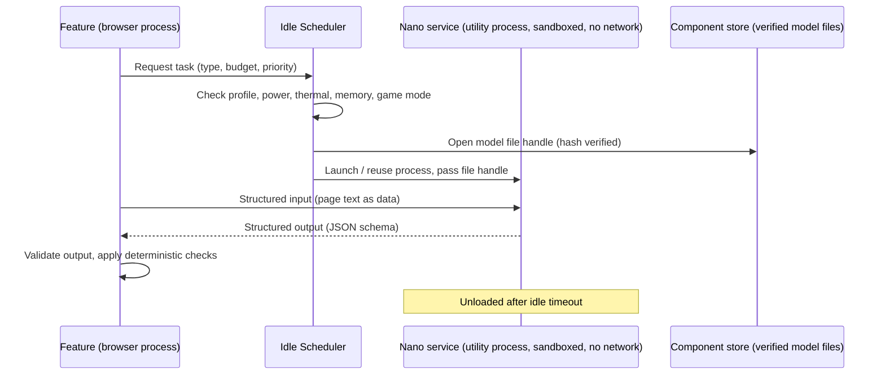

# Brumel Nano — Local AI Architecture

Status: **Research** — no model, runtime or feature has been implemented or benchmarked. Every model and runtime below is a candidate. Model sizes come from public sources (some third-party) and must be re-measured.

Related: [Architecture](ARCHITECTURE.md) · [ADR-0008](adr/0008-local-ai-runtime.md) · [Threat Model](../security/THREAT_MODEL.md) · [Privacy](../privacy/PRIVACY.md) · [Benchmarks](../benchmarks/BENCHMARKS.md)

## 1. Goals

- **Free**: no paid API, subscription or account required.
- **Optional**: off until the user enables it; the browser is complete without it.
- **Local**: runs on the device; no internet access during inference.
- **Separable**: downloaded as an independent component, removable completely (models, caches, indexes derived from it).
- **Light**: loaded on demand, unloaded after inactivity, gated by energy profile and hardware.
- **Specialized**: small task-specific models beat one general model for browser tasks.
- **Honest**: generative features ship only when they pass quality gates.

## 2. Non-goals

- A chat assistant as the main product feature.
- Autonomous agents acting on the web or the system (only as future Research under [Agent Clean Room](#9-agents-future-research)).
- AI for security-critical decisions.
- Training or fine-tuning on user data.
- Competing with large cloud models on open-ended generation.

## 3. Deterministic-first policy

Brumel Nano is cross-cutting technology, not a feature in itself. For every task the order of preference is:

1. **Rules and algorithms** (URL/domain heuristics, regexes, parsers, locale-aware date/number parsing, TF-IDF/BM25 over FTS5) — fastest, explainable, testable.
2. **Embeddings** (similarity, clustering, semantic search) — cheap at inference, no hallucination.
3. **Specialized models** (OCR, ASR, translation) — mature, task-specific.
4. **Small generative model** — only for tasks needing language generation (short names, labels, structured extraction with schema validation), with deterministic fallback.

| Task | Primary technique | AI involvement | Notes |
| --- | --- | --- | --- |
| Tab grouping | Domain/opener heuristics + embedding clustering | Embeddings | Group naming may use a small LM, with fallback to dominant domain/keyword |
| Group / space naming | Keyword extraction; small LM optional | Optional generative | Max ~4 words, validated |
| Page classification | Domain lists + embeddings + small classifier | Embeddings | Never used for security verdicts |
| Semantic search (Smart Memory) | Hybrid: FTS5/BM25 + embeddings, reciprocal rank fusion | Embeddings | Works with embeddings off (text only) |
| Tagging | Keyword extraction + embeddings nearest-tag | Embeddings | |
| Dates, amounts, units (Selection Actions, Receipt Vault, Subscription Radar) | Deterministic parsers (ICU, libphonenumber-like) | None by default; small LM with JSON schema only as fallback | Output always shows source text |
| Download classification | File type, source domain, rules | None / embeddings | |
| Command routing (Quick Actions) | Fuzzy matching over command registry | Optional FunctionGemma-class model | Model may only **propose** a command; never executes |
| Spellcheck | Hunspell (Chromium) | None | Grammar models: Research |
| Translation | Bergamot/Marian-class NMT | Specialized model | Per language pair download |
| OCR (Live Text) | OCR engine | Specialized model | |
| Speech recognition, captions, dictation | Whisper-family ASR | Specialized model | Heavy; GPU/NPU preferred |
| Extractive summary | Sentence ranking (TextRank-like, embeddings) | Embeddings | Default summary technique |
| Generative summary | Small LM | Generative | **Gated** by evaluation ([§8](#8-evaluation-and-quality-gates)) |
| Smart Compare | Deterministic table extraction + citations | Optional extraction | Every value links to its source; no unverified claims |

## 4. Candidate models

| Model | Parameters | Public footprint (approx.) | License | Candidate role | Status |
| --- | --- | --- | --- | --- | --- |
| Gemma 3 270M | 270M (170M embedding + 100M transformer) | ~125 MB INT4, ~240 MB Q8 (third-party estimates); 32K context | Gemma Terms of Use | Naming, short classification, schema extraction | Research |
| FunctionGemma | 270M (Gemma 3 270M fine-tune) | ~290–300 MB int8/Q8 | Gemma Terms of Use | Command routing proposals | Research |
| EmbeddingGemma | 308M | < 200 MB RAM quantized; Matryoshka dimensions; 100+ languages | Gemma Terms of Use | Embeddings for Memory, grouping, tagging | Research |
| Qwen3 0.6B | 0.6B | To be measured | Apache-2.0 | Alternative small LM with permissive license | Research |
| Gemma 3 1B | 1B | To be measured | Gemma Terms of Use | Higher-quality tier on capable hardware | Research |
| Newer small multilingual models | — | — | Varies | Re-evaluated every phase | Research |
| Multilingual permissive embedding models (e.g. E5/BGE/GTE-class small models) | ~100–600M | To be measured | Mostly MIT/Apache-2.0 (verify per model) | Permissive alternative to EmbeddingGemma | Research |
| Whisper-family ASR (tiny/base/small, distilled variants) | 39M–244M+ | To be measured | MIT (OpenAI Whisper; verify per variant) | Captions, dictation, Video Search | Research |
| OCR: Tesseract-class / PaddleOCR-class | — | To be measured | Apache-2.0 (verify) | Live Text | Research |
| Translation: Bergamot / Marian-class NMT (as used by Firefox Translations) | small per pair | To be measured | Engine MPL-2.0; models typically open licenses — verify per model | Page translation | Research |

### License caveat

Gemma models are distributed under the **Gemma Terms of Use**, which is not an OSI-approved open-source license and includes a prohibited-use policy that must be passed on to users. Before shipping any Gemma model, Brumel must confirm that redistribution through its component channel is permitted and how the terms are presented. Apache-2.0 or MIT alternatives (e.g. Qwen3 0.6B, permissive embedding models) are kept as fallbacks so that no essential feature depends on a single restricted license.

## 5. Runtimes and acceleration

| Runtime | License | Strengths | Concerns | Role |
| --- | --- | --- | --- | --- |
| **llama.cpp** (GGML/GGUF) | MIT | Efficient CPU inference, quantization, Vulkan/CUDA/HIP/Metal backends, small footprint | Large C/C++ surface parsing model files; must be sandboxed | Small generative models |
| **ONNX Runtime** | MIT (historically; the repository location changed — re-verify before adoption) | Broad model support; execution providers: DirectML (Windows GPUs), CUDA, ROCm/MIGraphX, OpenVINO (Intel CPU/GPU/NPU), Vitis AI / Ryzen AI (AMD NPU), QNN (Qualcomm NPU) | Binary size; EP availability varies by OS and driver | Embeddings, OCR, ASR, translation; NPU path |
| **WebNN** | W3C spec | Standard web API; Chromium implementation in progress | Availability and op coverage still evolving; aimed at web pages, not browser internals | Research: expose local acceleration to web apps later |
| Chromium on-device model service (used by Chrome for Gemini Nano) | Mixed | Integrated in Chromium tree | Chrome's model and parts of the execution library are Google-provided, not redistributable by Brumel | Not used; design studied for reference |

NPU acceleration is **Research**. Driver availability, operator coverage and real energy savings differ by vendor and OS and must be measured on the reference hardware ([Benchmarks](../benchmarks/BENCHMARKS.md)).

### Quantization

- Default: 4-bit or 8-bit weight quantization (GGUF Q4/Q8, ONNX INT8) selected per hardware tier.
- Every quantized artifact is evaluated against the task quality gate; a smaller model that fails is not shipped.

## 6. Process model and isolation

- **Sandboxed utility process** with the strictest sandbox Chromium offers for utility services, **no network access**, no file-system access except the model file handle passed by the browser process.
- **Mojo interface** accepts only typed requests; outputs are validated against schemas in the browser process.
- **Memory lifecycle**: load on first request; keep warm only while tasks are queued; unload after an idle timeout (proposed default: a few minutes, tuned by benchmarks) and immediately under memory pressure or when the Gaming profile activates.
- **Concurrency**: one Nano process at a time; tasks are queued by the Idle Scheduler.

## 7. Component distribution

- Nano is a downloadable component, not part of the installer.
- Manifests list model ID, version, size, license, SHA-256 hash and minimum hardware tier, and are **signed**. The client verifies signature and hash before use ([Threat Model §5.4](../security/THREAT_MODEL.md)).
- Users can import a model file manually (advanced), with a clear warning and the same sandboxing.
- "Remove Brumel Nano" deletes models, caches and derived embeddings (with an option to keep text indexes).

### Hardware tiers and energy gating

| Tier | Typical hardware | Default behavior |
| --- | --- | --- |
| T0 | ≤ 4 GB RAM or no AVX2 | Nano unavailable by default; deterministic features only |
| T1 | 8 GB RAM, CPU only | Embeddings only; generative off by default |
| T2 | 16 GB RAM or capable iGPU | Embeddings + small LM (270M–0.6B) |
| T3 | ≥ 16 GB + dGPU or NPU | All tiers, larger optional models, ASR |

Gating rules: disabled in Battery Saver and Gaming profiles; heavy jobs only on AC power unless the user opts in; never runs while a fullscreen game or exclusive-mode app is detected.

## 8. Evaluation and quality gates

No generative feature is enabled by default until it passes a published evaluation:

- **Task datasets** built from public, licensed web content (no user data), with multilingual coverage (at least English and Spanish initially).
- **Metrics** per task: accuracy/F1 for classification and extraction; nDCG/recall for search; human preference and factual consistency checks for summaries; latency, peak RAM and energy per request.
- **Gate**: a model must beat the deterministic baseline by a documented margin and stay within resource budgets on T1/T2 hardware.
- **Regression**: re-run on every model or runtime update.
- **Results published** in the repository with raw data.

## 9. Prompt-injection defenses

Web content is **untrusted data**. A page can contain text crafted to manipulate any model.

1. **Content is data, never instructions.** Page text is passed in delimited data fields; system prompts are fixed in the binary.
2. **Structured outputs only.** Models produce JSON validated against strict schemas (enums, lengths, formats). Free text is only displayed, never executed or interpreted as commands.
3. **No capabilities.** The Nano process has no network, no file access, no browser APIs. It cannot navigate, download, change settings or send data.
4. **Deterministic gates.** Any action derived from a model suggestion (move tab, rename group, run command) passes through the same permission checks as a user action, and destructive or outward-facing actions require explicit confirmation.
5. **Context isolation.** Tasks assemble context per task; content from one site is not mixed with another site's sensitive data unless the user explicitly asks (e.g. Smart Compare across selected tabs).
6. **Visible and undoable.** AI-made changes are labeled and reversible (Universal Undo).

## 10. Optional cloud and external providers

Opt-in only, configured per provider, never required:

| Provider type | Examples | Notes |
| --- | --- | --- |
| OpenAI-compatible APIs | OpenAI, compatible self-hosted servers | BYOK |
| Anthropic | Claude models | BYOK |
| Google | Gemini API | BYOK |
| Local servers | Ollama, llama.cpp server, LM Studio-compatible | Localhost or LAN, user-configured |
| Custom | Any HTTPS endpoint following a documented schema | Advanced |

Rules: per-request disclosure of what is sent and to whom; keys stored with OS-protected encryption; no provider is contacted unless configured; provider connections appear in Glass Box; disabled in incognito.

## 11. Agents (future research)

Autonomous agents, MCP integration and command execution are **Research only** (Agent Clean Room). They require a capability-based security model — explicit, scoped, revocable capabilities; isolated sessions; confirmation for every consequential action; full audit log — reviewed before any implementation.

## Rejected uses

| Use | Reason |
| --- | --- |
| Phishing/malware verdicts from a small LM | Not reliable enough; deterministic and reputation-based protection required |
| Granting permissions or trusting extensions based on AI | Security-critical |
| Executing commands or scripts suggested by a model from page content | Prompt injection |
| Factual comparisons presented without source verification | Hallucination risk |
| Default-on generative summaries before passing quality gates | Quality and trust |
| Training on user data | Privacy |
