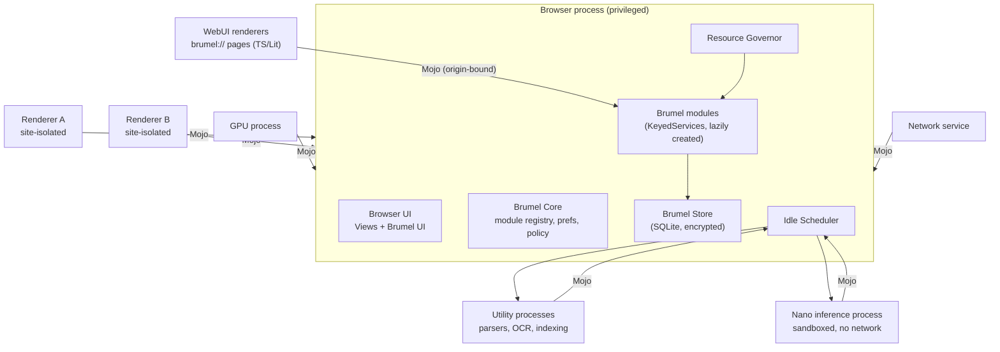

# Brumel Architecture

Status: **Planned** — proposed technical architecture written during pre-development. No Brumel code exists yet. Decisions are recorded as [ADRs](adr/README.md); anything marked *Proposed* or *Research* can still change.

Related: [Upstream Strategy](UPSTREAM_STRATEGY.md) · [AI Architecture](AI_ARCHITECTURE.md) · [Sync Architecture](SYNC_ARCHITECTURE.md) · [Compatibility](COMPATIBILITY.md) · [Threat Model](../security/THREAT_MODEL.md) · [Building](../development/BUILDING.md)

## 1. Goals and constraints

| Goal | Architectural consequence |
| --- | --- |
| Maximum web and extension compatibility | Stay as close to upstream Chromium as possible; change behavior through small patches and new components, not engine forks |
| Security parity with Chromium | Never weaken the sandbox, Site Isolation or mitigations ([SECURITY.md](../../SECURITY.md)) |
| Fast security updates | Minimal patch surface, automated rebases ([ADR-0003](adr/0003-patch-based-repository.md)) |
| Many features, low idle cost | Every optional module is lazily created and fully unloadable ([ADR-0006](adr/0006-in-process-modules.md)) |
| Local-first and private | Shared encrypted local store, no mandatory services ([ADR-0007](adr/0007-brumel-store-sqlite.md)) |
| Native, not Electron | Chromium Views + WebUI ([ADR-0005](adr/0005-native-ui-no-electron.md)) |

Non-goals: a new rendering engine, a new JavaScript engine, a cross-browser abstraction layer, or a plugin system that lets third parties run privileged native code.

## 2. Chromium process model (recap)

Brumel inherits Chromium's multi-process architecture unchanged:

- **Browser process** — privileged. Owns the UI (Views), profiles, preferences, storage, permissions and coordinates all other processes.
- **Renderer processes** — sandboxed, one or more per site (Site Isolation). Run Blink and V8 on untrusted web content.
- **GPU process** — compositing, rasterization and video decode/encode acceleration.
- **Network service** — all network I/O (typically its own process on desktop).
- **Utility processes** — sandboxed helpers (audio, storage, data decoding, printing, unzip, etc.).
- **Extension processes** — renderers for extension pages and service workers.

Processes communicate via **Mojo IPC**. Every Mojo interface that a less privileged process can call into a more privileged one is a security boundary.



## 3. Brumel layers mapped to the Chromium tree

Brumel code lives in its own top-level directory inside the Chromium checkout, created by the patch tooling, so that most Brumel code is **added files** rather than **modified files**. Modified upstream files are kept to the minimum hooks needed.

| Layer | Proposed location in the checkout | Contents |
| --- | --- | --- |
| Brumel Core | `//brumel/browser/core/` | Module registry, feature flags, Brumel prefs, policy integration, Glass Box connection registry |
| Module browser code | `//brumel/browser/<module>/` | `KeyedService` per profile, Mojo hosts, UI controllers |
| Reusable components | `//brumel/components/<name>/` | Code without `//chrome` dependencies (store, scheduler, filter engine bindings, sync protocol) — same layering rules as upstream `//components` |
| UI (native) | `//brumel/browser/ui/views/` | Vertical tabs, side panels, command palette, split view, toolbar items |
| UI (WebUI) | `//brumel/browser/resources/<page>/` + `//brumel/browser/ui/webui/` | Internal pages (`brumel://health`, `brumel://memory`, `brumel://glass-box`, settings sections) in TypeScript + Lit |
| Utility services | `//brumel/services/<name>/` | Sandboxed out-of-process services (indexer, OCR, Nano inference) |
| Rust crates | `//brumel/third_party/rust/` and `//brumel/components/*/rs/` | Memory-safe parsers and engines ([ADR-0010](adr/0010-rust-for-new-components.md)) |
| Hooks into upstream | Patches in `patches/brumel/core/` | Small, documented insertion points (e.g. registering factories, adding a toolbar slot) |

The checkout layout and patch conventions are defined in [`patches/README.md`](../../patches/README.md) and [Upstream Strategy](UPSTREAM_STRATEGY.md).

## 4. Modules

Modules are **logical product areas**, not processes. Each module is a set of features (catalogued in [FEATURES.md](../product/FEATURES.md)) that share code and data.

| Module | Responsibility | Main Chromium building blocks reused |
| --- | --- | --- |
| **Brumel Core** | Chromium parity, branding, update, distribution, module system, settings | `chrome/browser`, `components/prefs`, `components/policy`, updater |
| **Brumel Engine** | Performance profiles, budgets, tab lifecycle, diagnostics | `performance_manager`, tab discarding/freezing, Memory Saver, Energy Saver, task manager metrics |
| **Brumel Workspace** | Vertical tabs, trees, spaces, split view, identities, rules | tab strip model, tab groups, profiles, StoragePartitions, side panel |
| **Brumel Memory** | Time Machine, semantic/textual search, vaults, drafts | sessions service, history, `sql/` (SQLite + FTS), MHTML |
| **Brumel Shield** | Content blocking, anti-tracking, permissions, cleanup | declarativeNetRequest internals, `subresource_filter`, permissions, site settings |
| **Brumel Nano** | Local AI runtime and tasks | utility process + sandbox, component updater pattern |
| **Brumel Connect** | Sync, device mesh, sharing | WebRTC (in-tree), BoringSSL, `components/sync` concepts (not Google's backend) |
| **Brumel Tools** | Downloads, media, PDF, capture, reader, accessibility | download manager, media session, PDFium, screenshot, reader mode distiller |
| **Brumel Dev** | Developer tools beyond DevTools (Research) | DevTools frontend, proxy settings |

## 5. Module lifecycle: zero idle cost by default

The central product promise — *hundreds of features available, few running* — requires a strict lifecycle:

```mermaid
stateDiagram-v2
  [*] --> Compiled: build flag (buildflag) enables code
  Compiled --> Available: base::Feature enabled (field config / about:flags)
  Available --> Disabled: user pref off (default for optional modules)
  Available --> Dormant: user pref on
  Dormant --> Active: first real need (UI opened, event fires)
  Active --> Dormant: idle timeout, memory pressure, profile switch
  Active --> Disabled: user turns feature off
  Dormant --> Disabled: user turns feature off
  Disabled --> [*]: data offered for deletion
```

Rules:

1. **Build flags** remove a module entirely from a build (e.g. a "minimal" build profile).
2. **`base::Feature`** gates whether the module can exist at runtime.
3. **User preferences** decide whether it is on. Optional modules default to off unless they are part of the default experience (e.g. Clean Web).
4. **Lazy `KeyedService` creation**: services come from profile-keyed factories that are not created with the browser context (Chromium's default `ServiceIsCreatedWithBrowserContext()` returning `false`), so they are instantiated on first use, never at startup.
5. **Disabled means no observers, no timers, no network, no memory.** A disabled module must not register observers on hot paths (navigation, tab events). This is testable: browser tests assert that disabled modules have no live service instance and no scheduled tasks.
6. **Dormant services** release caches and close databases after an idle timeout.

Measuring idle cost of every module (with it off, dormant and active) is part of [BENCHMARKS.md](../benchmarks/BENCHMARKS.md).

## 6. Shared infrastructure

### 6.1 Brumel Store

One encrypted SQLite database per profile ([ADR-0007](adr/0007-brumel-store-sqlite.md)) instead of one database per feature:

- Accessed only through the browser process (`//brumel/components/store/`), on a dedicated sequenced task runner — never from renderers.
- Tables per feature with a shared schema-migration system and per-feature retention policies.
- **FTS5** for full-text search across Memory, vaults and downloads.
- Vector search for embeddings: **Research** (options: brute-force cosine over a compact table for small corpora, an in-process ANN index, or `sqlite-vec`-style extension — must be evaluated for licensing, security and size).
- Encryption at rest using Chromium's OSCrypt key management (DPAPI/app-bound on Windows, libsecret/KWallet on Linux). Whether to use page-level encryption (SQLCipher-like) or field-level encryption is a Research question in ADR-0007.
- Incognito profiles never open the Brumel Store.

### 6.2 Idle Scheduler

All deferrable background work (indexing, embedding, thumbnail generation, page-change checks, backups, model warm-up) is submitted to one scheduler instead of each feature owning timers:

- Inputs: user activity, power source, battery level, thermal state (where the OS exposes it), active performance profile, foreground fullscreen app / game detection, memory pressure.
- Policies: run only when idle and not on battery saver; pause instantly on user input; hard budgets per task class; jobs are resumable.
- Executes CPU-heavy jobs in sandboxed utility processes at background priority.

### 6.3 Resource Governor (Brumel Engine)

Brumel Engine does **not** invent new throttling machinery. It orchestrates mechanisms Chromium already has and tests well:

| Mechanism | Upstream basis | Brumel use |
| --- | --- | --- |
| Tab discarding | `TabLifecycleUnit`, Memory Saver | RAM budgets per space, Infinite Tabs |
| Tab freezing | Page freezing / BFCache-like freezing | Background tabs in Battery Saver |
| Timer throttling | Intensive wake-up throttling | Stronger budgets per profile |
| Energy Saver | Upstream battery saver mode (frame-rate limits, background work reduction) | Battery Saver profile, Thermal Guard |
| Process priority | `performance_manager` priority voting | Active-tab prioritization |
| Network priority | Fetch Priority / resource scheduler | Network Optimizer (only for traffic the browser controls) |
| Metrics | Task manager, `performance_manager` graph | Browser Health, Extension Doctor, Performance History |

Profiles (Performance, Balanced, Battery Saver; advanced: Gaming, Streaming, Developer, Focus, AI, Custom) are **policy bundles** over these mechanisms.

### 6.4 Privileged-component separation

- Code that parses untrusted data (web pages, files, images, audio, filter lists, model files, sync payloads) runs in the renderer or a sandboxed utility process, or is written in Rust with fuzzing.
- The browser process keeps orchestration, permissions and storage.
- WebUI pages get Mojo interfaces bound only to their own `brumel://` origin.
- No module receives capabilities it does not need (e.g. Memory cannot make network requests; Nano cannot access the file system or network).

## 7. Candidate technologies

| Technology | Use | Status |
| --- | --- | --- |
| C++ (Chromium style) | Browser integration, services | Accepted |
| Chromium Views | Native browser UI | Accepted ([ADR-0005](adr/0005-native-ui-no-electron.md)) |
| WebUI: TypeScript + Lit | Internal pages and settings | Accepted |
| Rust (in-tree toolchain) | Parsers, filter engine, sync crypto glue | Proposed ([ADR-0010](adr/0010-rust-for-new-components.md)) |
| SQLite + FTS5 | Brumel Store | Proposed ([ADR-0007](adr/0007-brumel-store-sqlite.md)) |
| Local embeddings | Semantic Memory search | Research ([AI Architecture](AI_ARCHITECTURE.md)) |
| ONNX Runtime | Embeddings, OCR, ASR, translation models | Proposed ([ADR-0008](adr/0008-local-ai-runtime.md)) |
| llama.cpp | Small generative models | Proposed ([ADR-0008](adr/0008-local-ai-runtime.md)) |
| adblock-rust | Native content blocking | Proposed ([ADR-0011](adr/0011-native-content-blocking.md)) |
| WebRTC (in-tree) | Device mesh, Quick Share | Proposed ([ADR-0009](adr/0009-local-first-e2ee-sync.md)) |
| PostgreSQL (server side) | Sync relay metadata and ciphertext storage | Proposed ([Sync Architecture](SYNC_ARCHITECTURE.md)) |
| Chromium updater (Omaha 4) | Windows updates | Proposed ([ADR-0012](adr/0012-update-system.md)) |

## 8. Repository layout

This repository holds Brumel's sources **as patches and added files**, never a full Chromium checkout ([ADR-0003](adr/0003-patch-based-repository.md)).

```text
brumel/
├── config/upstream.json        # pinned Chromium + ungoogled-chromium versions
├── patches/                    # quilt-style patch series applied to Chromium
│   ├── upstream-ungoogled/     # imported de-Googling patches (BSD-3-Clause)
│   └── brumel/                 # Brumel patches by area
├── src/ (planned)              # Brumel-added files copied into //brumel in the checkout
├── scripts/                    # fetch, apply, build, package, upstream checks
├── tests/                      # repository tests; browser tests live with code
├── docs/                       # product, architecture, security, privacy, research
└── assets/                     # branding
```

## 9. What Brumel will not do

- **No Electron** or any second bundled browser runtime.
- **No process per module** without a security or stability justification.
- **No disabling** of sandboxing, Site Isolation, V8 sandbox, CFI or other mitigations to win benchmarks.
- **No privileged native plugin API** for third parties. Extensions stay within the Chromium extension model.
- **No AI in security decisions** and no autonomous agents without a capability-based security model ([AI Architecture](AI_ARCHITECTURE.md)).
- **No heavy forking of Blink or V8.** Engine changes are upstreamed or not made.
- **No silent network connections.** Every endpoint is registered in Glass Box.

## 10. Open questions

| Question | Where it is tracked |
| --- | --- |
| Vector index technology and encryption granularity for the Brumel Store | [ADR-0007](adr/0007-brumel-store-sqlite.md) |
| Model selection per task and NPU acceleration | [AI Architecture](AI_ARCHITECTURE.md) |
| Safe Browsing replacement that keeps protection without Google dependence | [Privacy](../privacy/PRIVACY.md), [Compatibility](COMPATIBILITY.md) |
| Real build cost (disk, RAM, time) of the pinned Chromium on available hardware | [Building](../development/BUILDING.md) |
| Widevine licensing | [Compatibility](COMPATIBILITY.md) |
