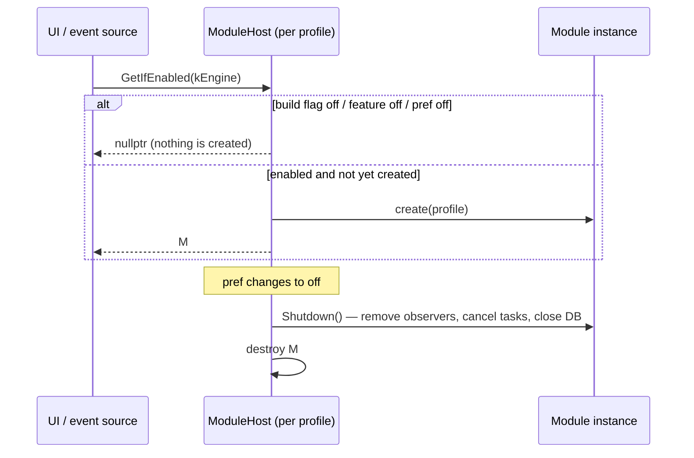

# Module system and feature registry — design

Status: **Planned** — design for review. Nothing here is implemented. It implements [ADR-0006](adr/0006-in-process-modules.md) and is step 4 of the [Phase 1 plan](../development/PHASE1_PLAN.md) (catalog `CORE-005`, issue [#70](https://github.com/Elgeryy1/brumel/issues/70)). Chromium class and file names are taken from upstream as of the 158 milestone and must be confirmed against the pinned checkout before implementation.

Related: [Architecture §3–5](ARCHITECTURE.md#5-module-lifecycle-zero-idle-cost-by-default) · [Upstream Strategy §5](UPSTREAM_STRATEGY.md#5-patch-budget-and-minimization-rules) · [Benchmarks](../benchmarks/BENCHMARKS.md)

## 1. Goals

1. **Off means zero.** A disabled module has no object instance, no observers, no timers, no posted tasks, no open files or databases, and no network activity.
2. **Few upstream hooks.** All module code lives in added files under `//brumel`. Upstream files change only to register Brumel once.
3. **One place to look.** A single registry lists every module and optional feature, with its catalog ID, gates and owner.
4. **Testable.** The zero-cost rule is enforced by browser tests and measured by the benchmark harness, not trusted.

Non-goals: a plugin system for third-party code, runtime loading of modules, and separate processes per module (ADR-0006).

## 2. Gates

Every module, and every optional feature inside a module, passes three gates in order:

| Gate | Mechanism | Who controls it | Naming |
|---|---|---|---|
| Compiled | GN build flag via `buildflag_header` | Build profile | `brumel_enable_<module>` → `BUILDFLAG(BRUMEL_ENABLE_<MODULE>)` |
| Available | `base::Feature` | Brumel (field config, `chrome://flags`) | `kBrumel<Name>` |
| On | Profile preference | User and enterprise policy | `brumel.<module>.enabled`, `brumel.<module>.<feature>.enabled` |

- The build flags live in `//brumel/build/buildflags.gni`. The `minimal` GN profile in [`config/gn/`](../../config/gn/minimal.gn) sets optional modules to `false`. That is what makes `minimal` different from `release`.
- Optional modules default to **off**. Modules that are part of the default experience (for example Clean Web) default to on and document why.
- A module whose build flag is off is not compiled at all. Its registry entry disappears through `#if BUILDFLAG(...)`.

## 3. Registry

`//brumel/browser/core/module_registry.{h,cc}` holds a **static, constant table**. Chromium forbids static initializers, so nothing registers itself at startup:

```cpp
// Sketch, not final code.
struct ModuleDescriptor {
  ModuleId id;                          // enum class, stable
  const char* catalog_id;               // e.g. "ENG-005"
  const base::Feature* feature;         // availability gate
  const char* enabled_pref;             // on/off gate
  bool default_enabled;
  std::unique_ptr<Module> (*create)(Profile*);  // called only when needed
};

inline constexpr ModuleDescriptor kModules[] = {
#if BUILDFLAG(BRUMEL_ENABLE_ENGINE)
  {ModuleId::kEngine, "EP-ENG-01", &kBrumelEngine, prefs::kEngineEnabled, false, &CreateEngineModule},
#endif
  // ...
};
```

A unit test checks the table against the feature catalog: every `catalog_id` exists in `features.json` or `epics.json`, IDs are unique, and every pref is registered.

## 4. Lifecycle



- **`ModuleHost`** is one `KeyedService` per profile, provided by a `ProfileKeyedServiceFactory` whose `ServiceIsCreatedWithBrowserContext()` returns `false`. It is the only Brumel object that may exist with every module off. Even then, it exists only after the first `Get`.
- `KeyedService` objects live until the profile is destroyed. A module therefore is **not** a `KeyedService` itself. `ModuleHost` owns `std::unique_ptr<Module>` instances, and can destroy one at any time to tear it down.
- **`Module`** is an interface with `Shutdown()` and `OnMemoryPressure()`. It also has `EnterDormant()`, which releases caches and closes the database after an idle timeout ([ARCHITECTURE §5](ARCHITECTURE.md#5-module-lifecycle-zero-idle-cost-by-default)).
- `ModuleHost` watches **only** the `brumel.*.enabled` prefs, with a single `PrefChangeRegistrar`. Turning a module off destroys its instance. Turning it on creates nothing until the next `GetIfEnabled`.
- Callers never cache raw module pointers across tasks. They hold a `base::WeakPtr` or call `GetIfEnabled` again.
- Modules that must react to events (navigation, tab changes) add their observers **inside** the module instance, never in `ModuleHost` or at startup. Code review checks this. The browser tests in §6 detect it.

## 5. Upstream hooks

The expected hooks, each a separate patch in `patches/brumel/core/`:

| Patch | Upstream file (to verify) | Change |
|---|---|---|
| `0001-build-brumel-target` | `chrome/browser/BUILD.gn` | Depend on `//brumel/browser` |
| `0002-register-keyed-service-factories` | `chrome/browser/profiles/chrome_browser_main_extra_parts_profiles.cc` | Call `brumel::EnsureBrowserContextKeyedServiceFactoriesBuilt()` |
| `0003-register-prefs` | `chrome/browser/prefs/browser_prefs.cc` | Call `brumel::RegisterProfilePrefs()` |
| `0004-register-webui` | `chrome/browser/ui/webui/chrome_web_ui_configs.cc` | Register the `chrome://brumel` test page |

That is four patches and an estimated 10–20 changed upstream lines. The patch budget is measured with `scripts/patches.py stats`.

The test page is served as `chrome://brumel` at first. A real `brumel://` scheme needs more invasive patches (scheme registration, URL display, security checks) and is decided separately.

## 6. Proving "off means zero"

| Check | Type | Assertion |
|---|---|---|
| Registry consistency | Unit test | Catalog IDs exist; IDs and prefs are unique; every module has a factory |
| Disabled module | Browser test (`BrumelModuleZeroCostTest`) | With the pref off: after startup, navigation and tab events, `ModuleHost::IsInstantiated(id)` is false and the module's instance counter is 0 |
| No startup work | Browser test | `ModuleHost` itself is not created during startup and first navigation when every optional module is off |
| Teardown | Browser test | Enable, use, then disable: the instance is destroyed, its observer count returns to 0, and no task posted by it runs afterwards |
| Idle cost | Benchmark | Memory, CPU wake-ups and startup time with every module off vs `minimal` build vs dormant vs active ([BENCHMARKS.md](../benchmarks/BENCHMARKS.md)) |

Each `Module` implementation keeps a debug-only live-instance counter and observer counter that tests can read. These counters are compiled out of release builds.

## 7. Source overlay

Brumel's added files live in this repository under `src/` and appear in the checkout as `//brumel`:

- [`scripts/overlay.py`](../../scripts/overlay.py) `sync --checkout DIR` mirrors `src/` into `<checkout>/src/brumel`. It copies new and changed files, deletes stale ones, and refuses to touch a `brumel/` directory it did not create.
- The overlay is **not committed** in the Chromium checkout. The sync step adds `/brumel/` to the checkout's `.git/info/exclude`, so `patches.py refresh` never mistakes overlay files for patch content.
- `fetch.py` refuses to put a Chromium checkout inside this repository, so `src/` is never confused with Chromium's `src/`.

## 8. Open questions

1. Whether per-feature gates inside a module need their own `Module` objects or only flags. The answer depends on the first real module (Engine, Phase 2).
2. Enterprise policy mapping for `brumel.*.enabled` prefs: one policy per module, or a single list policy.
3. Whether `ModuleHost` should exist for Incognito and Guest profiles, or modules opt in per profile type.
4. How the registry is shown to users: one settings page listing modules with their state, which also feeds the transparency view (`SHD-034`).
