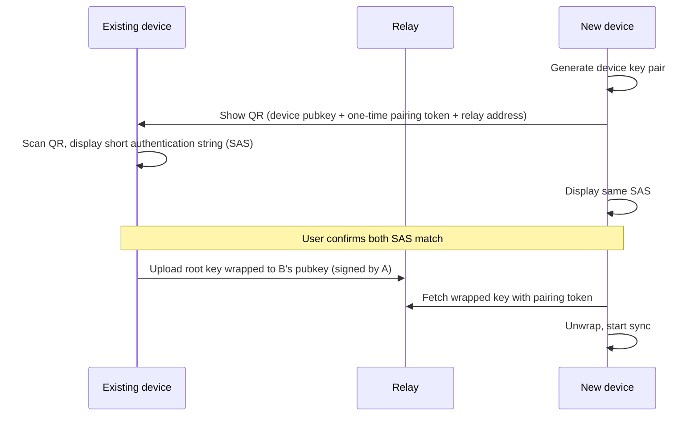

# Brumel Connect — Sync Architecture

Status: **Research** — design proposal. No protocol, client or server exists. The cryptographic design must be reviewed by people with applied cryptography experience before implementation, and externally audited before Public Beta.

Related: [ADR-0009](adr/0009-local-first-e2ee-sync.md) · [Threat Model §5.6](../security/THREAT_MODEL.md) · [Privacy](../privacy/PRIVACY.md) · [Infrastructure](../development/INFRASTRUCTURE.md)

## 1. Principles

1. **The browser works perfectly without sync and without an account.** Connect is an optional module.
2. **Local-first.** Each device holds a complete copy of its synced data and works offline. Servers are relays and mailboxes, not the source of truth.
3. **End-to-end encryption in the clients.** Servers — including a hosted provider such as Supabase — store ciphertext and must not be able to read content.
4. **Minimal metadata.** The server learns as little as possible about what is synced and when.
5. **Self-hostable.** A reference server runs from a Docker image.
6. **No dependency on any maintainer's personal hardware.** The official relay must run on infrastructure that does not require the maintainer's home equipment; self-hosting is a user choice.
7. **Password sync is Deferred** until a dedicated security review.

## 2. Data types

| Data type | Priority | Conflict strategy | Size profile | Status |
| --- | --- | --- | --- | --- |
| Bookmarks | P1 | Tree CRDT (move/rename ops) | Small | Planned |
| Open tabs / send tab | P1 | Per-device state, no merge (each device publishes its own) | Small | Planned |
| Workspaces, spaces, tab trees | P1 | Tree CRDT | Small–medium | Planned |
| Preferences | P1 | Per-key last-writer-wins (LWW) with hybrid logical clocks; device-local keys excluded | Small | Planned |
| Rules (Smart Router, site profiles) | P1 | Per-rule LWW | Small | Planned |
| Reading Queue, Tab Snooze | P2 | Set CRDT (add/remove) | Small | Planned |
| History | P2, opt-in | Grow-only set with tombstones for deletion | Medium–large | Planned |
| Extensions list (compatible) | P3, opt-in | Set CRDT | Small | Research |
| Clipboard | P3, opt-in per use | Ephemeral, not stored server-side beyond delivery | Small | Research |
| Offline Vault, Receipt Vault blobs | P3 | Content-addressed blobs, immutable | Large | Research |
| Brumel Memory index | — | Not synced; rebuilt locally from synced sources | — | Rejected (privacy/size) |
| Passwords, passkeys | — | — | — | **Deferred** (security review) |

## 3. Data model

- Every change is an **operation** `(record_id, op_type, payload, hlc_timestamp, device_id, seq)`.
- Operations are grouped per data type into **encrypted batches**.
- Devices merge operations deterministically (CRDT semantics per type), so the same set of operations always produces the same state regardless of order.
- Periodic **snapshots** (encrypted) compact the log; old operations are garbage-collected after all known devices acknowledge them.
- Deletion uses tombstones with expiry so that offline devices converge.

## 4. Encryption scheme (candidate)

Primitives come from libraries already in the Chromium tree (BoringSSL) or a well-audited library such as libsodium; no custom cryptography.

| Key | Purpose | Where it lives |
| --- | --- | --- |
| Device identity key pair (Ed25519 / X25519) | Device authentication, key wrapping | Generated on device; private key protected by OS keystore (OSCrypt / TPM-backed where available) |
| Account root key (256-bit random) | Root of the sync key hierarchy | Never leaves devices in plaintext; wrapped per device |
| Per-data-type keys | Encrypt batches of one data type; enable selective sharing and rotation | Derived from or wrapped by the root key (HKDF) |
| Recovery key | Restore when all devices are lost | Shown once as a recovery code; user stores it |

- **Authenticated encryption**: XChaCha20-Poly1305 or AES-256-GCM with random nonces; associated data binds `account_id`, `data_type`, `batch_id` and `seq` to prevent replay and swapping.
- **Signatures**: batches signed with the device key so a compromised server cannot inject operations.
- **Key wrapping**: the root key is encrypted to each device's X25519 public key; the server stores only wrapped keys.
- **Rotation**: removing a device triggers root and data-type key rotation; new data uses new keys; old data is re-encrypted lazily.
- **Recovery**: the recovery code derives a wrapping key (Argon2id or scrypt with strong parameters) for an encrypted copy of the root key. Losing all devices and the recovery code means data loss — this is the honest cost of E2EE.
- **Protocol candidates to study** before designing anything custom: MLS (RFC 9420) for group key management across devices, and existing designs such as Firefox Sync (onepw/BrowserID-derived), Brave Sync v2 (chain-of-trust via sync code) and Chromium's custom passphrase mode.

## 5. Device pairing

- Pairing requires an existing trusted device **or** the recovery code.
- The device list is visible on every device; adding a device notifies all others.
- Pairing tokens are single-use and short-lived.

## 6. Transport

| Path | Use | Notes |
| --- | --- | --- |
| **Relay of encrypted blobs** (HTTPS) | Default for all data types; mailbox for offline devices | Server stores ciphertext batches and wrapped keys |
| **WebRTC device mesh** | Direct device-to-device transfer when both are online (Quick Share, large blobs, faster convergence) | Uses in-tree WebRTC; signalling via relay; DTLS-SRTP/SCTP data channels **plus** application-layer E2EE; TURN fallback |
| **LAN discovery** | Same-network transfers | Research: mDNS discovery has privacy implications; opt-in |

TURN relays see only encrypted traffic but do see IP addresses and timing; using TURN is a disclosed fallback.

## 7. Server options

| Option | Description | Cost | Notes |
| --- | --- | --- | --- |
| **Supabase Free** (candidate for the official relay in early phases) | PostgreSQL + auth + storage; Row Level Security restricts every row to its account | Free tier with quotas (database size, storage, egress, project pausing on inactivity — verify current limits) | Server sees ciphertext and minimal metadata only; free-tier limits make it suitable for alpha/beta testers, not for large scale |
| **Self-hosted reference server** | Docker image: small API service + PostgreSQL + object storage (S3-compatible) | User's own | Same protocol; documented deployment |
| **Managed PostgreSQL / object storage elsewhere** | Any provider | Varies | Requires owner approval for any paid service |

Server responsibilities: authenticate devices (signature-based, not passwords), store and serve encrypted batches and wrapped keys, enforce quotas, deliver push hints. It never decrypts.

### Metadata minimization

| Metadata | Visible to server? | Mitigation |
| --- | --- | --- |
| Account identifier | Yes | Random identifier, not an email, unless the user adds an email for recovery notices (optional) |
| Device identifiers | Yes | Random, rotatable |
| Data type of a batch | Partly | Batch type identifiers can be opaque per account (keyed hash) |
| Batch sizes | Yes | Padding to size buckets |
| Timing | Yes | Batching and jitter |
| IP addresses | Yes (transport) | Not logged beyond abuse protection windows; documented retention |

## 8. Offline behavior

- All edits apply locally first; the operation log is queued.
- On reconnect, devices upload pending batches and download others; CRDT merge resolves conflicts automatically.
- Conflicts that cannot be merged meaningfully (e.g. the same bookmark moved to two folders) are resolved deterministically and recorded so the user can review them in a "sync history" view.

## 9. Backups

- Encrypted local backups (Planned) independent of sync.
- Encrypted backup export to a user-chosen location (file, external drive, user's own cloud folder).

## 10. Quotas and costs

- Per-account quotas protect free infrastructure (proposed: generous for bookmarks/settings, limited for history and blobs).
- History sync and blob sync are opt-in partly because of storage cost.
- Cost estimates will be published in [Infrastructure](../development/INFRASTRUCTURE.md) once real payload sizes are measured. No paid service is used without the owner's approval.

## 11. Threat considerations (summary)

See [Threat Model §5.6](../security/THREAT_MODEL.md). Key points: a compromised server cannot read or forge data; it can withhold or delete it (mitigated by local-first copies and backups); metadata is minimized but not zero; pairing attacks are mitigated by SAS confirmation and device notifications.

## 12. Open questions

- MLS versus a simpler wrapped-root-key design for a small number of devices.
- CRDT library choice (existing Rust CRDT libraries vs a minimal custom implementation per data type).
- Whether Supabase Auth is needed at all, or device-signature authentication is sufficient.
- Exact Supabase Free limits and how project pausing affects a sync relay.
- Requirements for a future password sync design (separate review, possibly separate keys and stricter recovery).
