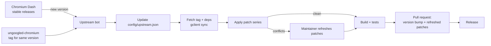

# Upstream Strategy

Status: **Planned** — process defined during pre-development. [`scripts/upstream/check_upstream.py`](../../scripts/upstream/check_upstream.py) reports whether the pinned version in [`config/upstream.json`](../../config/upstream.json) matches the current Chromium stable release (Available). [`scripts/fetch.py`](../../scripts/fetch.py) and [`scripts/patches.py`](../../scripts/patches.py) fetch the pin and manage the patch series ([ADR-0013](adr/0013-git-backed-patch-tooling.md)). They are In Development and not yet validated against a real checkout.

Related: [ADR-0002](adr/0002-chromium-base-selection.md) · [ADR-0003](adr/0003-patch-based-repository.md) · [Chromium Bases](../research/CHROMIUM_BASES.md) · [Building](../development/BUILDING.md) · [`patches/README.md`](../../patches/README.md)

## 1. Why this matters most

For a Chromium-based browser, **security is mostly the delay between an upstream security fix and its arrival on users' machines.** Every Brumel patch makes rebases slower. This strategy exists to keep that delay short while carrying Brumel's features.

## 2. Model



- **Pinned upstream.** Brumel builds an exact Chromium stable tag (e.g. `158.0.8127.88`) recorded in `config/upstream.json`, never a moving branch.
- **ungoogled-chromium alignment.** De-Googling patches are imported from the ungoogled-chromium tag that matches the pinned Chromium version (their tags use `<chromium version>-<revision>`). When ungoogled-chromium lags, Brumel either waits or carries the previous patch set forward with fixes — decided per release based on severity.
- **Patch series on top.** Brumel's changes are an ordered series of patches plus added files ([ADR-0003](adr/0003-patch-based-repository.md)).

## 3. Release rhythm

Chromium ships a new major version roughly every four weeks, with security respins in between. Brumel follows:

| Upstream event | Brumel action | Goal (once releases exist) |
| --- | --- | --- |
| Security respin on current major (patch version bump) | Bump pin, re-apply patches (usually clean), build, release | Release within 7 days of upstream stable for critical/high fixes |
| New major version | Rebase full series, refresh conflicts, run full test suite | Release within 14 days of upstream stable |
| Chrome stable promotes an emergency fix for an exploited bug | Same as security respin, highest priority | As fast as possible; target 72 hours for in-the-wild exploits |

These are goals for a single-maintainer project and will be published honestly against actuals (see [Metrics](#8-metrics)). If a release is late, Browser Health shows users that their build is behind the current upstream security release.

## 4. Patch series

### Categories

| Directory | Contents | License |
| --- | --- | --- |
| `patches/upstream-ungoogled/` | Imported ungoogled-chromium patches (unmodified or minimally adapted) | BSD-3-Clause (upstream) |
| `patches/brumel/branding/` | Name, icons, strings, channel names | BSD-3-Clause (modifies Chromium files) |
| `patches/brumel/core/` | Hooks: factory registration, build integration, settings entry points | BSD-3-Clause |
| `patches/brumel/degoogle/` | Brumel-specific service removals and replacements beyond ungoogled-chromium | BSD-3-Clause |
| `patches/brumel/<module>/` | Feature hooks per module (engine, workspace, memory, shield, nano, connect, tools, ui, dev) | BSD-3-Clause |
| `patches/brumel/fixes/` | Bug fixes, ideally upstreamable | BSD-3-Clause |
| `src/` (planned) | **Added** Brumel files copied into `//brumel` | MPL-2.0 |

Licensing follows [ADR-0004](adr/0004-licensing.md).

### Series file

A quilt-style `patches/series` file lists patches in application order, one per line, grouped by category with comments. `scripts/patches.py apply` applies them with `git apply --index` (optionally `--3way`), one commit per patch, and stops at the first conflict. `refresh` exports resolved commits back to patch files ([ADR-0013](adr/0013-git-backed-patch-tooling.md)). The file stays usable with `quilt push -a`.

### Naming and headers

```text
patches/brumel/engine/0003-expose-discard-policy-hook.patch
```

Every patch starts with a header:

```text
Description: Expose a hook so Brumel Engine can veto or request tab discards.
Origin: brumel
Module: engine
Feature: ENG-0xx
Upstreamable: maybe
SPDX-License-Identifier: BSD-3-Clause
```

Details: [`patches/README.md`](../../patches/README.md).

## 5. Patch budget and minimization rules

1. **Add, don't modify.** Prefer new files under `//brumel` and a one-line registration hook over editing upstream logic.
2. **Use upstream extension points** (features, prefs, policies, delegates, observers, `BUILD.gn` deps) before patching.
3. **One purpose per patch.** Small patches rebase better and review better.
4. **No reformatting** of upstream code.
5. **Budget.** The number of modified upstream files and changed lines is tracked per release. A pull request that increases modified upstream lines significantly must justify it.
6. **Prefer configuration.** GN args and runtime flags over code changes when they achieve the same result.
7. **Delete aggressively.** When upstream gains an equivalent capability, drop the Brumel patch.

## 6. Upstreaming policy

- Bug fixes and general improvements are offered to Chromium when they are useful beyond Brumel. Chromium contributions require the contributor to accept Google's CLA; patches for upstreaming are therefore kept under BSD-3-Clause.
- Patches useful to ungoogled-chromium are offered there.
- Upstreaming is encouraged but never a release blocker.

## 7. Automation (planned)

| Job | Trigger | Runs where | Output |
| --- | --- | --- | --- |
| `check-upstream` | Scheduled (e.g. every 6 hours) | GitHub-hosted runner | Issue or PR when a new stable version appears ([`check_upstream.py`](../../scripts/upstream/check_upstream.py)) |
| `patch-apply-check` | New version detected | Runner with a cached checkout (self-hosted, trusted branches only) | Report of clean / conflicting patches |
| `rebase-pr` | Patches apply | Same | PR with bumped pin, refreshed patches, diff summary |
| `build-and-test` | PR from trusted branch | Self-hosted runners | Artifacts, test results |
| `release` | Tag signed by maintainer | Isolated release environment | Signed binaries, SBOM, checksums, provenance |

Hosted runners cannot build Chromium within standard time and disk limits (see [Infrastructure](../development/INFRASTRUCTURE.md)), so full builds run on private, maintainer-owned machines with the safeguards described there. Pull requests from forks never run on those machines.

## 8. Metrics

Published per release once releases exist:

- Upstream version and release delay (days between upstream stable and Brumel release).
- Number of patches, modified upstream files and changed lines.
- Patches that conflicted during the rebase and time spent refreshing them.
- Patches dropped because upstream gained the capability.

## 9. Risks

| Risk | Mitigation |
| --- | --- |
| ungoogled-chromium lags or changes direction | Brumel can carry forward its own de-Googling patches; dependency is per-patch, not total |
| Large upstream refactor breaks many patches | Small patches, hooks instead of logic changes, early testing against Beta channel (Research) |
| Maintainer unavailable | Documented process, automation, co-maintainers before Version 1.0 ([Governance](../../GOVERNANCE.md)) |
| Build hardware unavailable | Documented requirements, option of temporarily paid build capacity (owner approval required) |
