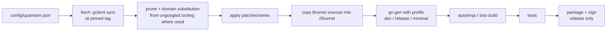

# Building Brumel

Status: **In Development** — Brumel cannot be built yet. The fetch, patch and build scripts exist (step 1 of the [Phase 1 plan](PHASE1_PLAN.md)), but they have **not yet been run against a real Chromium checkout**. The resource figures below are planning assumptions until the build spike ([#61](https://github.com/Elgeryy1/brumel/issues/61)) replaces them with measurements.

Related: [Upstream Strategy](../architecture/UPSTREAM_STRATEGY.md) · [ADR-0003](../architecture/adr/0003-patch-based-repository.md) · [Infrastructure](INFRASTRUCTURE.md) · [`patches/README.md`](../../patches/README.md)

## 1. What exists today vs. what is planned

| Component | Status |
| --- | --- |
| Pinned upstream version (`config/upstream.json`) | Available (candidate pin, not yet built) |
| Upstream version check (`scripts/upstream/check_upstream.py`) | Available |
| Patch series conventions (`patches/README.md`) | Available (no patches yet) |
| Fetch script (`scripts/fetch.py`) | In Development — written and unit-tested, not yet run against Chromium |
| Patch apply / refresh / check tooling (`scripts/patches.py`, [ADR-0013](../architecture/adr/0013-git-backed-patch-tooling.md)) | In Development — tested on small repositories; `check` runs in CI |
| GN argument profiles ([`config/gn/`](../../config/gn/dev.gn)) | In Development — guard runs in CI; arguments not yet validated by a build |
| Build wrapper (`scripts/build.py`) | In Development — not yet run against Chromium |
| Brumel source overlay (`scripts/overlay.py`: `src/` → `//brumel`) | In Development — tested; `src/` holds no browser code yet |
| Packaging (Windows installer, Linux packages) | Planned |
| CI build pipeline | Planned |

## 2. Upstream toolchain

Brumel uses Chromium's standard toolchain:

- **depot_tools** — `gclient`, `gn`, `autoninja`, helper scripts.
- **gclient** — fetches `chromium/src` at the pinned tag and its DEPS (third-party repos, toolchains, test data).
- **GN** — generates build files from `BUILD.gn` with arguments (`args.gn`).
- **Ninja / Siso** — executes the build. Upstream has been moving from Ninja to **Siso** as its build executor, with remote execution support; local builds remain possible. Brumel will follow upstream defaults for the pinned version (to be verified per version). Remote execution services used by Google are not available to Brumel; a self-hosted remote-execution/cache backend is Research.
- **Clang/LLVM, lld, Rust toolchain** — downloaded by Chromium's hooks; Brumel uses upstream's pinned toolchains rather than system compilers.

### Windows

- Windows 10/11 x64.
- Visual Studio (Community edition is sufficient for open-source work, subject to its license terms) with the "Desktop development with C++" workload, and the Windows SDK version required by the pinned Chromium (exact versions to be verified from upstream build docs for that version).
- Debugging Tools for Windows.
- NTFS volume with long-path support; antivirus exclusions for the checkout to keep builds tractable (documented risk trade-off).

### Linux

- A recent x64 distribution supported by upstream instructions (Ubuntu LTS is the common choice).
- Dependencies installed with upstream's `build/install-build-deps.sh`.
- Sysroots downloaded by hooks for reproducible builds against a fixed glibc baseline.

## 3. Resource requirements (to be validated)

Upstream documentation and community experience indicate that Chromium builds are among the heaviest open-source builds. Brumel will measure and publish real values on its reference hardware in Phase 1. Until then, the following are **planning assumptions, not measurements**:

| Resource | Planning assumption | Notes |
| --- | --- | --- |
| Disk | Well over 100 GB free for checkout + one output directory; more for multiple configurations and caches | SSD/NVMe strongly recommended |
| RAM | 32 GB or more for comfortable full builds; less works with fewer parallel jobs | Linker steps are memory-hungry |
| CPU | As many cores as possible; full builds take hours on typical desktop hardware | Incremental builds are much faster |
| Network | Initial fetch downloads many gigabytes | Shallow / no-history fetches reduce size |

## 4. Planned Brumel build flow



### Commands

Every command that downloads, changes a checkout or builds **prints its plan and stops** unless `--execute` is given. Run it once without `--execute` and read the plan first.

```text
# 1. Fetch the pinned Chromium tag and its dependencies (many GB, long).
python3 scripts/fetch.py --checkout <checkout dir> [--execute]

# 2. Apply patches/series, one Git commit per patch (resumable).
python3 scripts/patches.py apply --checkout <checkout dir> [--3way] [--execute]

# 2b. Mirror Brumel's own sources (src/) into the checkout as //brumel.
python3 scripts/overlay.py sync --checkout <checkout dir> [--execute]

# 3. Write out/<Profile>/args.gn, run gn gen, then autoninja.
python3 scripts/build.py build --checkout <checkout dir> --profile dev|release|minimal [--target chrome] [--execute]

# After resolving conflicts in the checkout: export the commits back to patches/.
python3 scripts/patches.py refresh --checkout <checkout dir> [--execute]

# No checkout needed (these run in CI):
python3 scripts/patches.py check     # series and header rules
python3 scripts/patches.py stats     # patch budget
python3 scripts/build.py check       # GN profile guard
python3 scripts/build.py args --profile release
```

`<checkout dir>` must live **outside** this repository, on a path without spaces. On Windows keep it short (for example `C:\src\brumel`) and enable long-path support. `fetch.py` checks free disk space (default minimum 100 GB, a planning assumption), the required tools and the path. If `config/upstream.json` records a `revision`, it also checks that the tag still points to it. It records the resolved commit and source tree in `<checkout dir>/.brumel/fetch.json`, so two machines can compare their checkouts.

On Windows the scripts set `DEPOT_TOOLS_WIN_TOOLCHAIN=0`, so depot_tools uses the locally installed Visual Studio instead of Google's internal toolchain package.

Packaging (`scripts/package.py`) is Planned (CORE-009, CORE-010).

### GN argument profiles

Profiles live in [`config/gn/`](../../config/gn/dev.gn). `_common.gn` holds arguments shared by every profile, and a profile inherits another with a `# brumel-inherit: <name>` line. `scripts/build.py` composes the final `args.gn` and **refuses** any profile that:

- sets Google API keys or leaves `use_official_google_api_keys` enabled;
- sets security hardening arguments (`is_cfi`, `use_cfi_icall`, `v8_enable_sandbox`, `v8_enable_pointer_compression`, `use_partition_alloc`) to `false`;
- makes an official build a debug or component build.

| Profile | Purpose | Key characteristics (to be finalized) |
| --- | --- | --- |
| `dev` | Fast iteration | `is_debug=false`, `is_component_build=true`, `symbol_level=1`, DCHECKs on |
| `release` | Shipping builds | `is_official_build=true`, `is_component_build=false`, LTO per upstream official config, `chrome_pgo_phase=0` until PGO profiles are evaluated (Research), CFI and all upstream security hardening unchanged |
| `minimal` | Measure idle cost / low-end | Identical to `release` for now; optional Brumel modules will be compiled out via build flags once the module system exists |

Security-relevant arguments (sandbox, CFI, V8 sandbox, hardening) are **never** turned off in `release`.

Brand and service arguments: Brumel builds use no Google API keys. Codec and Widevine flags are decided per [Compatibility](../architecture/COMPATIBILITY.md) and [Licensing](../legal/LICENSING.md).

## 5. Incremental development

- Developers keep a local Git branch inside their Chromium checkout, develop there, and export changes back to `patches/` and `src/` with the refresh tooling.
- Component builds and targeted test binaries (`browser_tests --gtest_filter=Brumel*`, `unit_tests`) keep iteration fast.

## 6. Reproducibility goals

- Pinned upstream tag, pinned toolchains (from upstream), pinned Brumel commit and recorded `args.gn` for every release.
- Build provenance attestation and SBOM per release.
- Bit-for-bit reproducibility: **Research**. Some upstream components embed timestamps or paths; Brumel will document which artifacts are reproducible.

## 7. Phase 1 validation checklist

- [x] Write fetch, patch and build tooling with unit tests ([Phase 1 plan](PHASE1_PLAN.md), step 1).
- [ ] Fetch pinned tag and measure download size and time.
- [ ] Build unmodified Chromium at the pin on Windows and Linux reference machines; record disk, peak RAM and wall time.
- [ ] Apply a minimal ungoogled subset and branding; build and smoke-test.
- [ ] Measure incremental build times for typical Brumel changes.
- [ ] Decide Ninja vs Siso per upstream defaults; evaluate a self-hosted cache.
- [ ] Publish results in this document, replacing the planning assumptions.
