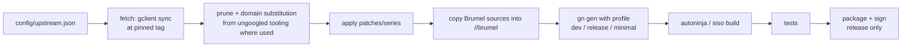

# Building Brumel

Status: **Planned** — Brumel cannot be built yet. This document describes the intended build strategy and the requirements that must be validated in **Phase 1 — Technical Foundation**. It does not describe working scripts: the only script that exists today is [`scripts/upstream/check_upstream.py`](../../scripts/upstream/check_upstream.py), which checks the pinned upstream version.

Related: [Upstream Strategy](../architecture/UPSTREAM_STRATEGY.md) · [ADR-0003](../architecture/adr/0003-patch-based-repository.md) · [Infrastructure](INFRASTRUCTURE.md) · [`patches/README.md`](../../patches/README.md)

## 1. What exists today vs. what is planned

| Component | Status |
| --- | --- |
| Pinned upstream version (`config/upstream.json`) | Available (candidate pin, not yet built) |
| Upstream version check (`scripts/upstream/check_upstream.py`) | Available |
| Patch series conventions (`patches/README.md`) | Available (no patches yet) |
| Fetch script (pinned Chromium + dependencies) | Planned |
| Patch apply / refresh tooling | Planned |
| GN argument profiles | Planned |
| Build wrapper | Planned |
| Packaging (Windows installer, Linux packages) | Planned |
| CI build pipeline | Planned |

## 2. Upstream toolchain

Brumel uses Chromium's standard toolchain:

- **depot_tools** — `gclient`, `gn`, `autoninja`, helper scripts.
- **gclient** — fetches `chromium/src` at the pinned tag and its DEPS (third-party repos, toolchains, test data).
- **GN** — generates build files from `BUILD.gn` with arguments (`args.gn`).
- **Ninja / Siso** — executes the build. Upstream has been moving from Ninja to **Siso** as its build executor, with remote execution support; local builds remain possible. Brumel will follow upstream defaults for the pinned version (to be verified per version). Remote execution services used by Google are not available to Brumel; a self-hosted remote-execution/cache backend is Research.
- **Clang/LLVM, lld, Rust toolchain** — downloaded by Chromium's hooks; Brumel uses upstream's pinned toolchains rather than system compilers.

### Windows

- Windows 10/11 x64.
- Visual Studio (Community edition is sufficient for open-source work, subject to its license terms) with the "Desktop development with C++" workload, and the Windows SDK version required by the pinned Chromium (exact versions to be verified from upstream build docs for that version).
- Debugging Tools for Windows.
- NTFS volume with long-path support; antivirus exclusions for the checkout to keep builds tractable (documented risk trade-off).

### Linux

- A recent x64 distribution supported by upstream instructions (Ubuntu LTS is the common choice).
- Dependencies installed with upstream's `build/install-build-deps.sh`.
- Sysroots downloaded by hooks for reproducible builds against a fixed glibc baseline.

## 3. Resource requirements (to be validated)

Upstream documentation and community experience indicate that Chromium builds are among the heaviest open-source builds. Brumel will measure and publish real values on its reference hardware in Phase 1. Until then, the following are **planning assumptions, not measurements**:

| Resource | Planning assumption | Notes |
| --- | --- | --- |
| Disk | Well over 100 GB free for checkout + one output directory; more for multiple configurations and caches | SSD/NVMe strongly recommended |
| RAM | 32 GB or more for comfortable full builds; less works with fewer parallel jobs | Linker steps are memory-hungry |
| CPU | As many cores as possible; full builds take hours on typical desktop hardware | Incremental builds are much faster |
| Network | Initial fetch downloads many gigabytes | Shallow / no-history fetches reduce size |

## 4. Planned Brumel build flow



Planned commands (illustrative; **they do not exist yet**):

```text
scripts/fetch.py      --config config/upstream.json --out <checkout dir>
scripts/patches.py    apply   --checkout <checkout dir>
scripts/patches.py    refresh --checkout <checkout dir>   # after resolving conflicts
scripts/build.py      --profile dev|release|minimal --target brumel
scripts/package.py    --platform win|linux
```

### GN argument profiles (planned)

| Profile | Purpose | Key characteristics (to be finalized) |
| --- | --- | --- |
| `dev` | Fast iteration | `is_debug=false`, `is_component_build=true`, `symbol_level=1`, DCHECKs on |
| `release` | Shipping builds | `is_official_build=true`, `is_component_build=false`, LTO/PGO per upstream official config where feasible, `chrome_pgo_phase` as supported, CFI and all upstream security hardening unchanged |
| `minimal` | Measure idle cost / low-end | Optional Brumel modules compiled out via build flags |

Security-relevant arguments (sandbox, CFI, V8 sandbox, hardening) are **never** turned off in `release`.

Brand and service arguments: Brumel builds use no Google API keys. Codec and Widevine flags are decided per [Compatibility](../architecture/COMPATIBILITY.md) and [Licensing](../legal/LICENSING.md).

## 5. Incremental development

- Developers keep a local Git branch inside their Chromium checkout, develop there, and export changes back to `patches/` and `src/` with the refresh tooling.
- Component builds and targeted test binaries (`browser_tests --gtest_filter=Brumel*`, `unit_tests`) keep iteration fast.

## 6. Reproducibility goals

- Pinned upstream tag, pinned toolchains (from upstream), pinned Brumel commit and recorded `args.gn` for every release.
- Build provenance attestation and SBOM per release.
- Bit-for-bit reproducibility: **Research**. Some upstream components embed timestamps or paths; Brumel will document which artifacts are reproducible.

## 7. Phase 1 validation checklist

- [ ] Fetch pinned tag and measure download size and time.
- [ ] Build unmodified Chromium at the pin on Windows and Linux reference machines; record disk, peak RAM and wall time.
- [ ] Apply a minimal ungoogled subset and branding; build and smoke-test.
- [ ] Measure incremental build times for typical Brumel changes.
- [ ] Decide Ninja vs Siso per upstream defaults; evaluate a self-hosted cache.
- [ ] Publish results in this document, replacing the planning assumptions.
