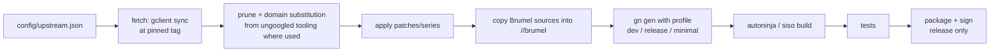

# Building Brumel

Status: **In Development** — unmodified Chromium at the pin has been fetched and built with these scripts on Linux (`release` and `dev`, measured in section 3); the Windows `release` build was not finished. A branded, de-Googled Brumel build has not been made yet. The fetch, patch and build scripts are step 1 of the [Phase 1 plan](PHASE1_PLAN.md); the build spike is [#61](https://github.com/Elgeryy1/brumel/issues/61).

Related: [Upstream Strategy](../architecture/UPSTREAM_STRATEGY.md) · [ADR-0003](../architecture/adr/0003-patch-based-repository.md) · [Infrastructure](INFRASTRUCTURE.md) · [`patches/README.md`](../../patches/README.md)

## 1. What exists today vs. what is planned

| Component | Status |
| --- | --- |
| Pinned upstream version (`config/upstream.json`) | Available (candidate pin; commit recorded after the first verified fetch, not yet built) |
| Upstream version check (`scripts/upstream/check_upstream.py`) | Available |
| Patch series (`patches/series`, conventions in `patches/README.md`) | In Development — 1 build fix, 15 ungoogled-chromium patches and 1 branding patch; they apply to the pin in order, not yet built |
| Fetch script (`scripts/fetch.py`) | In Development — written and unit-tested, not yet run against Chromium |
| Patch apply / refresh / check tooling (`scripts/patches.py`, [ADR-0013](../architecture/adr/0013-git-backed-patch-tooling.md)) | In Development — tested on small repositories; `check` runs in CI |
| GN argument profiles ([`config/gn/`](../../config/gn/dev.gn)) | In Development — guard runs in CI; arguments not yet validated by a build |
| Build wrapper (`scripts/build.py`) | In Development — not yet run against Chromium |
| Brumel source overlay (`scripts/overlay.py`: `src/` → `//brumel`) | In Development — tested; `src/` holds the `BRANDING` file and no browser code yet |
| Branding: `BRANDING` through `branding_file_path`, strings through `scripts/rebrand.py` ([ADR-0015](../architecture/adr/0015-branding-without-string-patches.md)) | In Development — dry run against the pinned checkout; not yet built |
| Packaging (Windows installer, Linux packages) | Planned |
| CI build pipeline | Planned |

## 2. Upstream toolchain

Brumel uses Chromium's standard toolchain:

- **depot_tools** — `gclient`, `gn`, `autoninja`, helper scripts.
- **gclient** — fetches `chromium/src` at the pinned tag and its DEPS (third-party repos, toolchains, test data).
- **GN** — generates build files from `BUILD.gn` with arguments (`args.gn`).
- **Ninja / Siso** — executes the build. Upstream has been moving from Ninja to **Siso** as its build executor, with remote execution support; local builds remain possible. Brumel will follow upstream defaults for the pinned version (to be verified per version). Remote execution services used by Google are not available to Brumel; a self-hosted remote-execution/cache backend is Research.
- **Clang/LLVM, lld, Rust toolchain** — downloaded by Chromium's hooks; Brumel uses upstream's pinned toolchains rather than system compilers.

### Windows

- Windows 10/11 x64.
- Visual Studio (Community edition is sufficient for open-source work, subject to its license terms) with the "Desktop development with C++" workload, and the Windows SDK version required by the pinned Chromium (exact versions to be verified from upstream build docs for that version).
- Debugging Tools for Windows.
- NTFS volume with long-path support; antivirus exclusions for the checkout to keep builds tractable (documented risk trade-off).

### Linux

- A recent x64 distribution supported by upstream instructions (Ubuntu LTS is the common choice).
- Dependencies installed with upstream's `build/install-build-deps.sh`.
- Sysroots downloaded by hooks for reproducible builds against a fixed glibc baseline.
- **Ubuntu 23.10 and later block unprivileged user namespaces with AppArmor**, so a locally
  built browser stops at start with "No usable sandbox!". Never work around it with
  `--no-sandbox`. Give the build output its own AppArmor profile instead, the same rule
  Ubuntu ships for Google Chrome (`/etc/apparmor.d/chrome`), as described in upstream's
  [AppArmor user namespace restrictions](https://chromium.googlesource.com/chromium/src/+/main/docs/security/apparmor-userns-restrictions.md):

  ```text
  # /etc/apparmor.d/brumel-dev  (load with: sudo apparmor_parser -r /etc/apparmor.d/brumel-dev)
  abi <abi/5.0>,
  include <tunables/global>

  profile brumel-dev /path/to/checkout/src/out/*/chrome flags=(unconfined) {
    userns,
    @{exec_path} mr,
    include if exists <local/brumel-dev>
  }
  ```

  Do not turn the restriction off system-wide (`kernel.apparmor_restrict_unprivileged_userns=0`).

## 3. Resource requirements

### Measured (Phase 1 build spike, Chromium 158.0.8127.88)

Unmodified Chromium at the pin (revision `0cefb182`, source tree `2c650cb2` on both
machines), built with `scripts/build.py --jobs N` and the pre-branding GN profiles.
The only change was the build-only patch
`brumel/fixes/0001-limit-blink-bindings-parallelism`. Times are wall-clock. Peak RAM
is the drop in available memory during the run, so it includes the file cache the
build pushed out and is an upper bound.

| Measurement | Linux: 8-core/16-thread desktop CPU, 28 GB RAM, NVMe, Ubuntu LTS | Windows: 12-core/24-thread laptop CPU, 32 GB RAM (about 13 GB free beside other apps), NVMe |
| --- | --- | --- |
| Fetch (`fetch.py`, no history) | 386 s (6.4 min) | Not timed precisely |
| Checkout size, without `out/` | 29 GB | Not measured |
| `release` full build | **6,869 s (1 h 54 min)**, `--jobs 12`, 57,721 steps; lowest free RAM 10.9 GB (peak ≈ 13.5 GB) | Not finished. Three segments, `--jobs 8`: 2,348 s, ~816 s (ended by sleep) and 980 s; lowest free RAM 2.75 GB |
| `release` output directory | 23 GB; `chrome` binary 1.85 GB | — |
| `dev` full build | **6,924 s (1 h 55 min)** in three segments: 2,110 s and 3,096 s with `--jobs 12`, then 1,718 s with `--jobs 16`; lowest free RAM 10.9 GB. Output directory 16 GB | Not run |
| `dev` incremental (touch `chrome/browser/ui/browser.cc`) | **16 s**: one compile (10 s) and one link (2 s); peak RAM ≈ 3.4 GB | Not run |

What the spike found:

- **Parallelism, not CPU, is the limit on 32 GB machines.** Default parallelism (`-j`
  equal to the logical CPU count) hung the Windows laptop. `--jobs` now also sets
  GN's `action_pool_depth`, because GN actions are not limited by `-j`.
- **Blink's bindings generators exhausted memory on their own.** About ten of them
  run at once, and each starts one Python worker per CPU. The build-only patch
  runs them one at a time with at most 8 workers (`BLINK_BINDINGS_JOBS` overrides).
- **Keep 12–16 GB free for `--jobs 12`.** On the Linux machine free RAM never fell
  below 10.9 GB with 12 jobs.
- **The `dev` profile is for iteration, not for the first build.** Its full build costs
  about as much as `release`, because the component build has more steps, but one
  `.cc` change rebuilds in seconds. A change to a widely included header rebuilds far
  more (not measured yet).
- **16 jobs used the 16 hardware threads** on the Linux machine with 13 GB still free;
  the CPU held about 4.9 GHz at its 95 °C design limit.
- **A clean stop is resumable.** Stopping a build and running the same command later
  continues where it stopped; no `gn clean` is needed.

### Planning assumptions (still unmeasured)

| Resource | Planning assumption | Notes |
| --- | --- | --- |
| Disk | Over 100 GB free for checkout, one output directory and caches; more for several configurations | SSD/NVMe strongly recommended |
| RAM | 32 GB for comfortable full builds; 16 GB should work with `--jobs 4` or fewer (not measured) | Linker steps are memory-hungry |
| CPU | As many cores as possible | Incremental builds are much faster |

## 4. Planned Brumel build flow



### Commands

Every command that downloads, changes a checkout or builds **prints its plan and stops** unless `--execute` is given. Run it once without `--execute` and read the plan first.

```text
# 1. Fetch the pinned Chromium tag and its dependencies (many GB, long).
python3 scripts/fetch.py --checkout <checkout dir> [--execute]

# 2. Apply patches/series, one Git commit per patch (resumable).
python3 scripts/patches.py apply --checkout <checkout dir> [--3way] [--execute]

# 2b. Mirror Brumel's own sources (src/) into the checkout as //brumel.
#     Required before gen: the profiles read //brumel/branding/BRANDING.
python3 scripts/overlay.py sync --checkout <checkout dir> [--execute]

# 2c. Rebrand the user-visible strings and their translations (ADR-0015).
#     Leaves uncommitted changes; undo with 'rebrand.py revert' before re-applying patches.
python3 scripts/rebrand.py apply --checkout <checkout dir> [--execute]

# 3. Write out/<Profile>/args.gn, run gn gen, then autoninja.
python3 scripts/build.py build --checkout <checkout dir> --profile dev|release|minimal [--target chrome] [--execute]

# After resolving conflicts in the checkout: export the commits back to patches/.
python3 scripts/patches.py refresh --checkout <checkout dir> [--execute]

# No checkout needed (these run in CI):
python3 scripts/patches.py check     # series and header rules
python3 scripts/patches.py stats     # patch budget
python3 scripts/build.py check       # GN profile guard
python3 scripts/build.py args --profile release
```

`<checkout dir>` must live **outside** this repository, on a path without spaces. On Windows keep it short (for example `C:\src\brumel`) and enable long-path support. `fetch.py` checks free disk space (default minimum 100 GB, a planning assumption), the required tools and the path. If `config/upstream.json` records a `revision`, it also checks that the tag still points to it. It records the resolved commit and source tree in `<checkout dir>/.brumel/fetch.json`, so two machines can compare their checkouts.

On Windows the scripts set `DEPOT_TOOLS_WIN_TOOLCHAIN=0`, so depot_tools uses the locally installed Visual Studio instead of Google's internal toolchain package.

Packaging (`scripts/package.py`) is Planned (CORE-009, CORE-010).

### GN argument profiles

Profiles live in [`config/gn/`](../../config/gn/dev.gn). `_common.gn` holds arguments shared by every profile, and a profile inherits another with a `# brumel-inherit: <name>` line. `scripts/build.py` composes the final `args.gn` and **refuses** any profile that:

- sets Google API keys or leaves `use_official_google_api_keys` enabled;
- sets security hardening arguments (`is_cfi`, `use_cfi_icall`, `v8_enable_sandbox`, `v8_enable_pointer_compression`, `use_partition_alloc`) to `false`;
- makes an official build a debug or component build.

| Profile | Purpose | Key characteristics (to be finalized) |
| --- | --- | --- |
| `dev` | Fast iteration | `is_debug=false`, `is_component_build=true`, `symbol_level=1`, DCHECKs on |
| `release` | Shipping builds | `is_official_build=true`, `is_component_build=false`, LTO per upstream official config, `chrome_pgo_phase=0` until PGO profiles are evaluated (Research), CFI and all upstream security hardening unchanged |
| `minimal` | Measure idle cost / low-end | Identical to `release` for now; optional Brumel modules will be compiled out via build flags once the module system exists |

Security-relevant arguments (sandbox, CFI, V8 sandbox, hardening) are **never** turned off in `release`.

Brand and service arguments: Brumel builds use no Google API keys. Codec and Widevine flags are decided per [Compatibility](../architecture/COMPATIBILITY.md) and [Licensing](../legal/LICENSING.md).

## 5. Incremental development

- Developers keep a local Git branch inside their Chromium checkout, develop there, and export changes back to `patches/` and `src/` with the refresh tooling.
- Component builds and targeted test binaries (`browser_tests --gtest_filter=Brumel*`, `unit_tests`) keep iteration fast.

## 6. Reproducibility goals

- Pinned upstream tag, pinned toolchains (from upstream), pinned Brumel commit and recorded `args.gn` for every release.
- Build provenance attestation and SBOM per release.
- Bit-for-bit reproducibility: **Research**. Some upstream components embed timestamps or paths; Brumel will document which artifacts are reproducible.

## 7. Phase 1 validation checklist

- [x] Write fetch, patch and build tooling with unit tests ([Phase 1 plan](PHASE1_PLAN.md), step 1).
- [x] Fetch pinned tag and measure download time (Linux; size not measured).
- [ ] Build unmodified Chromium at the pin on Windows and Linux reference machines; record disk, peak RAM and wall time (Linux done; Windows not finished).
- [ ] Apply a minimal ungoogled subset and branding; build and smoke-test. Linux `dev` done: the
  series applied with no conflicts, the build took 124 s after the unmodified `dev` build,
  `chrome://version` reports "Brumel 158.0.8127.88" and `chrome://sandbox` reports "adequately
  sandboxed" (namespaces and seccomp-BPF). Browsing, icons, `release` and Windows are still open.
- [ ] Measure incremental build times for typical Brumel changes (one `.cc` file measured in section 3; headers and patch changes not yet).
- [ ] Decide Ninja vs Siso per upstream defaults; evaluate a self-hosted cache.
- [ ] Publish results in this document, replacing the planning assumptions.
